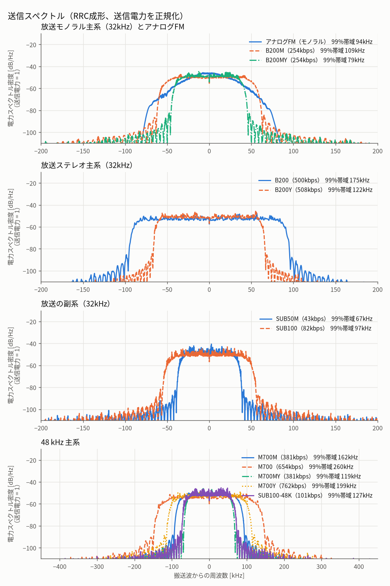

# GraceFM 評価・測定結果

本ドキュメントは、[方式仕様](SPEC.md) に対するオフラインシミュレーションの評価値・測定結果、および設計上のパラメータ選定の根拠をまとめたものです。実機の RF 性能、同期取得、法規適合性を示すものではありません。

## 1. ビットレートと送信帯域

表の上半分は Haar、下半分は `-L`（LeGall 5/3）のプロファイルである。音声量は [SPEC 2節](SPEC.md#2-帯域別の量子化と音声データ量) の $`R_{\rm audio}`$、シンボルレートはプリアンブルと Y 専用シンボルを含む $`R_s`$ である。理論支持幅は無限長 RRC の式 $`B_{\rm RRC}=(1+\beta)R_s`$ による両側帯域幅である。99% 占有帯域は 4 秒の `piano`（モノラル形）音源を連続フレーム化し、8 倍サンプルの RRC 波形について Welch 法で推定した電力スペクトルの 0.5%〜99.5% 点間を測った値。[測定スクリプト](../tools/report/spectrum.py) と [数値 JSON](results/spectrum.json) を参照。

| 系列 | ID | プロファイル | 変調 | 音声量 kb/s | シンボル/フレーム | $`R_s`$ ksym/s | $`\beta`$ | 理論支持幅 kHz | 99%占有帯域 kHz |
|---|---:|---|---|---:|---:|---:|---:|---:|---:|
| 放送モノラル | 1 | B200M | 階層16QAM | 254 | 197 | 98.5 | 0.25 | 123.125 | 108.7 |
| 放送ステレオ | 2 | B200 | 階層16QAM | 500 | 345 | 172.5 | 0.1 | 189.75 | 174.9 |
| 放送モノラル | 3 | B200MY | 階層16QAM＋Y | 254 | 144 | 72 | 0.25 | 90 | 78.9 |
| 放送ステレオ | 4 | B200Y | 階層16QAM＋Y | 508 | 240 | 120 | 0.1 | 132 | 122.1 |
| 32 kHz副系 | 5 | SUB50M | QPSK | 43 | 122 | 61 | 0.25 | 76.25 | 67 |
| 32 kHz副系 | 6 | SUB100 | QPSK | 82 | 176 | 88 | 0.25 | 110 | 97.1 |
| 48 kHz主系 | 7 | M700M | 階層16QAM | 381 | 197 | 147.75 | 0.25 | 184.688 | 162.5 |
| 48 kHz主系 | 8 | M700 | 階層16QAM | 654 | 313 | 234.75 | 0.25 | 293.438 | 260.4 |
| 48 kHz主系 | 9 | M700MY | 階層16QAM＋Y | 381 | 144 | 108 | 0.25 | 135 | 118.5 |
| 48 kHz主系 | 10 | M700Y | 階層16QAM＋Y | 762 | 240 | 180 | 0.25 | 225 | 198.6 |
| 48 kHz副系 | 11 | SUB100-48K | QPSK | 101.25 | 155 | 116.25 | 0.25 | 145.312 | 127.1 |
| 放送モノラル | 1 | B200M-L | 階層16QAM | 246 | 193 | 96.5 | 0.25 | 120.625 | 106.5 |
| 放送ステレオ | 2 | B200-L | 階層16QAM | 492 | 341 | 170.5 | 0.1 | 187.55 | 173.2 |
| 放送モノラル | 3 | B200MY-L | 階層16QAM＋Y | 246 | 140 | 70 | 0.25 | 87.5 | 77 |
| 放送ステレオ | 4 | B200Y-L | 階層16QAM＋Y | 492 | 232 | 116 | 0.1 | 127.6 | 117.8 |
| 32 kHz副系 | 5 | SUB50M-L | QPSK | 43 | 122 | 61 | 0.25 | 76.25 | 67 |
| 32 kHz副系 | 6 | SUB100-L | QPSK | 82 | 176 | 88 | 0.25 | 110 | 97.3 |
| 48 kHz主系 | 7 | M700M-L | 階層16QAM | 369 | 193 | 144.75 | 0.25 | 180.938 | 159.2 |
| 48 kHz主系 | 8 | M700-L | 階層16QAM | 546 | 277 | 207.75 | 0.25 | 259.688 | 228.8 |
| 48 kHz主系 | 9 | M700MY-L | 階層16QAM＋Y | 369 | 140 | 105 | 0.25 | 131.25 | 115.9 |
| 48 kHz主系 | 10 | M700Y-L | 階層16QAM＋Y | 738 | 232 | 174 | 0.25 | 217.5 | 191.7 |
| 48 kHz副系 | 11 | SUB100-48K-L | QPSK | 101.25 | 155 | 116.25 | 0.25 | 145.312 | 128.3 |

*図1：同じ素材で生成した連続フレームの複素ベースバンド PSD。各波形の平均送信電力を 1 に正規化した。*

- Y 系は、Y 帯域（2 kHz 以上の 3 帯域）の仮数を Haar 係数部から外し、1 係数 1 シンボルの位相に最上位 bit とそのパリティを載せ、区間アッテネータも 4 区間ずつに粗くするため、Y 無しの主系より占有帯域が小さい（B200MY は B200M より約 30 kHz、B200Y は B200 より約 53 kHz、M700MY は M700M より約 44 kHz、M700Y は M700 より約 62 kHz）。B200Y の 99% 占有帯域は 122.1 kHz、M700Y は 198.6 kHz で、どちらも 200 kHz を下回る。
- 主系の `-L` は仮数を狭めたため、$`R_s`$ が Haar より 1.2〜11.5% 小さく、99% 占有帯域は 1.7〜31.6 kHz 狭い（B200-L で 1.7 kHz、M700-L で 31.6 kHz）。副系の `-L` は Haar とシンボル数が同じだが、送る値が違うので 99% 占有帯域は最大 1.2 kHz 広い（SUB100-48K-L）。
- 99% 占有帯域と理論支持幅は異なる。測定した放送主系は B200M で約 109 kHz、B200 で約 175 kHz であり、−30 dB 幅はプロファイルごとに異なる（[数値 JSON](results/spectrum.json)）。ステレオで帯域を下げるには、S の高域か高域 M の幅を減らす必要があり、音質が大きく下がる。単一主系の値を主系＋副系 2 周波数の合計帯域と混同してはならない。占有帯域の測定だけで 180 kHz チャンネルへの適合や隣接チャネル漏洩は保証できない。

## 2. 16 bit PCM との比較とダイナミックレンジ

音声量を同じサンプリング周波数・チャンネル数の 16 bit PCM と比べる。**圧縮率**は 16 bit PCM のビットレート（$`f_s\times`$チャンネル数$`\times16`$）を音声量で割った値。**PCM 換算 bit**は、コーデックだけを通した波形 SNR から理想的な一様量子化の関係 $`(\mathrm{SNR}-1.76)/6.02`$ で bit 数に直した値で、`demo`・`piano`・`percussion`（各 10 秒）の平均である。これは音楽のレベルでの値で、ダイナミックレンジではない。係数は帯域ごとに共有指数（4 bit）を持つ浮動小数点に近い形なので、入力が小さくなっても相対精度が保たれ、下のとおり波形 SNR は広い範囲でほぼ一定である。[測定スクリプト](../tools/report/pcm_equivalent.py) と [数値 JSON](results/pcm_equivalent.json) を参照。

| 系列 | プロファイル | 音声量 kb/s | 16 bit PCM kb/s | 圧縮率 | 波形SNR dB | PCM換算 bit |
|---|---|---:|---:|---:|---:|---:|
| 放送モノラル | B200M | 254 | 512 | 2.02 | 55.8 | 9.0 |
| 放送ステレオ | B200 | 500 | 1024 | 2.05 | 54.8 | 8.8 |
| 放送モノラル | B200MY | 254 | 512 | 2.02 | 56.1 | 9.0 |
| 放送ステレオ | B200Y | 508 | 1024 | 2.02 | 55.8 | 9.0 |
| 32 kHz副系 | SUB50M | 43 | 512 | 11.91 | 23.6 | 3.6 |
| 32 kHz副系 | SUB100 | 82 | 1024 | 12.49 | 22.4 | 3.4 |
| 48 kHz主系 | M700M | 381 | 768 | 2.02 | 57.0 | 9.2 |
| 48 kHz主系 | M700 | 654 | 1536 | 2.35 | 47.7 | 7.6 |
| 48 kHz主系 | M700MY | 381 | 768 | 2.02 | 57.2 | 9.2 |
| 48 kHz主系 | M700Y | 762 | 1536 | 2.02 | 56.6 | 9.1 |
| 48 kHz副系 | SUB100-48K | 101.25 | 1536 | 15.17 | 22.0 | 3.4 |

主系は約 2 倍の圧縮で、波形 SNR は 55〜57 dB（PCM 換算で 8.8〜9.2 bit）である。M700 だけが 7.6 bit と低い。素材別の波形 SNR は `demo` 40.5 dB、`piano` 49.3 dB、`percussion` 53.4 dB で、`demo` が低い。副系は低域だけを送るため、帯域外が欠け、圧縮率は 12〜15 倍、波形 SNR は 22〜24 dB（3.4〜3.6 bit）にとどまる。`-L` の主系は仮数を狭めたので、音声量が Haar より 2〜17% 少なく、圧縮率は 2.08〜2.81 倍である。それでも波形 SNR は主系のすべてで Haar より 0.3〜1.3 dB 高い（B200M-L 56.7 dB、B200-L 56.1 dB、M700-L 48.5 dB、M700Y-L 57.1 dB）。副系は幅が同じで、SUB50M-L が 29.5 dB である（全プロファイルは数値 JSON）。

### 入力レベルと波形 SNR

入力の振幅を下げ、コーデックだけを通した波形 SNR（dB）を測った（`piano` / 1 kHz 正弦波。0 dB はピーク 0.89）。

| プロファイル | 0 dB | −40 dB | −60 dB | −80 dB | −90 dB | −100 dB |
|---|---:|---:|---:|---:|---:|---:|
| B200M | 52.6 / 54.3 | 52.6 / 49.1 | 46.3 / 46.9 | 26.6 / 39.8 | 18.6 / 27.8 | 13.2 / 19.6 |
| B200 | 50.7 / 54.3 | 50.6 / 49.1 | 43.4 / 46.9 | 23.6 / 39.8 | 15.6 / 27.8 | 10.7 / 19.6 |
| M700M | 55.0 / 51.6 | 55.0 / 48.7 | 46.4 / 52.6 | 26.7 / 39.8 | 20.1 / 28.2 | 14.8 / 18.1 |
| M700 | 49.3 / 51.6 | 48.5 / 48.7 | 35.0 / 52.6 | 23.8 / 39.8 | 16.9 / 28.2 | 12.6 / 18.1 |

`piano` では B200M・B200・M700M とも入力が −40 dB まで下がっても波形 SNR はほぼ変わらない（M700 は −40 dB で 48.5 dB、−60 dB で 35.0 dB に下がる）。正弦波ではさらに −60 dB まで 47〜54 dB を保ち、−90 dB で約 28 dB、−100 dB で約 18〜20 dB である。−120 dB では 7〜8 dB になる（係数の小数 22 bit による下限）。

**ダイナミックレンジと bit 数。** 波形 SNR が 20 dB を下回り始める入力レベル（測定点の間は直線補間）を下限とし、フルスケールからの幅を bit 数にした。**フルスケールからの幅**は下限レベルを 6.02 dB/bit で割った値、**同等 PCM bit**は 1 kHz 正弦波で理想的な一様量子化の PCM が同じ 20 dB を得るのに必要な bit 数（$`\mathrm{SNR}=6.02n+1.76+\text{入力ピーク dB}`$ から $`n`$ を解いた値）である。

| プロファイル | 正弦波の下限 dB | フルスケールからの幅 bit | 同等PCM bit | pianoの下限 dB |
|---|---:|---:|---:|---:|
| B200M | -99.5 | 16.5 | 19.6 | -88.2 |
| B200MY | -101.8 | 16.9 | 19.9 | -89.9 |
| B200 | -99.5 | 16.5 | 19.6 | -84.5 |
| B200Y | -101.8 | 16.9 | 19.9 | -88.2 |
| M700M | -98.1 | 16.3 | 19.3 | -90.2 |
| M700MY | -102.9 | 17.1 | 20.1 | -91.2 |
| M700 | -98.1 | 16.3 | 19.3 | -85.5 |
| M700Y | -102.9 | 17.1 | 20.1 | -89.1 |

1 kHz 正弦波の下限は 98〜103 dB で、フルスケールからの幅は 16.3〜17.1 bit、同じ 20 dB を 16 bit PCM で得るには 19.3〜20.1 bit が必要になる。`piano` では下限が 85〜91 dB で、正弦波より 8〜15 dB 高い。可逆化の前の測定と比べると、正弦波の下限は 0.2〜2.3 dB 上がった（M700MY の −105.2 dB から −102.9 dB が最大）。通信路を通した場合の下限は測っていない。20 dB 以外の基準や、SNR が 0 dB になるレベルも測っていない。入力レベルごとの波形 SNR の全数値は [JSON](results/pcm_equivalent.json) にある。

## 3. LeGall 5/3（`-L`）と Haar の比較

`python tools/eval/eval_legall.py --json docs/results/legall_link.json` の結果（[全144件](results/legall_link.json)）。`-L` は [SPEC 1.1節](SPEC.md#11-legall-53-の帯域分割-l-プロファイル) のとおり仮数を狭めた配分で、Haar よりビット数が少ない。理想同期の AWGN である。各セルは SNR dB / ViSQOL（試聴素材の参照音声 10 秒、48 kHz で評価）。主系＋既定の副系で、融合と PLC を含む。

| プロファイル | 素材 | C/N0 | Haar | `-L` |
|---|---|---:|---:|---:|
| B200M | demo | 66 | 40.68 / 3.02 | 42.03 / 4.65 |
| B200M | demo | 60 | 39.13 / 2.79 | 39.96 / 4.58 |
| B200M | percussion | 60 | 33.92 / 3.95 | 38.00 / 4.67 |
| B200M | piano | 60 | 30.26 / 2.05 | 36.40 / 2.95 |
| B200 | demo | 66 | 38.88 / 2.94 | 39.53 / 4.62 |
| B200 | percussion | 66 | 34.38 / 4.09 | 38.26 / 4.68 |
| B200 | piano | 66 | 29.57 / 2.17 | 33.46 / 3.19 |
| B200MY | percussion | 60 | 30.83 / 3.39 | 36.08 / 4.48 |
| B200MY | piano | 60 | 27.06 / 1.60 | 34.81 / 2.61 |
| M700Y | demo | 66 | 31.23 / 2.49 | 30.61 / 4.63 |

- 主系が多く届く C/N0 60 と 66 の 24 組（4 プロファイル×3 素材×2 条件）で、ViSQOL はすべて `-L` が高く（0.47〜2.14 の差）、SNR は 22 組で `-L` が高い。ステレオの B200 は ViSQOL が 0.59〜1.95 上がり、SNR は demo の 60（0.01 dB の低下で、ほぼ同じ）を除いて 0.65〜4.31 dB 上がる。もう一つの例外は M700Y の demo の 66（0.62 dB の低下）である。M700Y の demo は誤差の 6 割ほどが 12 kHz 以上にあり、仮数を狭める前の測定では `-L` で 3 kHz 以上の誤差が 0.24〜1.40 dB 増え、3 kHz 未満は 0.78〜0.81 dB 減った。最高域帯の雑音利得（4.1 節の +1.58 dB）と辻褄が合うが、切り分けはしていない。
- 主系の約半分以上が欠落する条件（C/N0 54 と、B200・M700Y の 57）では、SNR の差は 0.04〜2.23 dB と小さく、ViSQOL が下がる組もある（B200 の piano の 54 で −0.12、B200 の percussion の 57 と M700Y の percussion の 54 で −0.05、B200M の percussion の 54 で −0.03、B200 の percussion の 54 で −0.01）。ViSQOL の上昇幅は SNR の改善に対して大きく、聴感との対応は本書では確認していない。
- フレーム欠落には弱くなる。強い信号（80 dB-Hz）の 1 系統でランダムにフレームを落として PLC だけで埋めると、補間するサンプルが 1.4〜1.7 倍になり、SNR は 24 組のうち 23 組で下がる（最大 6.19 dB。例外は B200 の percussion の欠落 5% で、0.21 dB 上がる）。ViSQOL は 24 組のうち 13 組で下がり、piano の多くでは上がる（M700Y の欠落 1% で +1.90）。B200M は欠落 5% で、demo が 3.79 から 3.18 へ、piano が 3.42 から 3.25 へ下がる。副系があれば片系統の欠落は融合で埋まるので、`-L` は副系と組み合わせる前提に向く。

## 4. 設計トレードオフと補足測定

### 4.1 帯域分割の誤差・雑音漏れ・最悪利得

- **可逆リフティングと正規直交尺度の差**: 雑音の大きさは係数の尺度ではなく共有指数の刻みで決まるので、$`\sqrt2`$ 倍で正規直交にそろえた形と比べても、音楽の誤差は平均すればほぼ変わらない。ただし局所的には差がある。B200M と B200M-L の 3 素材（通信路なしと、C/N0 66 dB-Hz の 1 系統。B200M-L の仮数を狭める前の測定）で、帯域別の誤差の平均の差は最大 0.40 dB だが、フレームごとの差は 5〜95 パーセンタイルで約 ±2 dB ある。定常音では 6 dB 刻みの指数によって SNR が振幅で上下し、可逆にするとこの山谷の位置がずれる。通信路なしの SNR の差は Haar で −4.3〜+5.5 dB、5/3 で −8.3〜+29.9 dB と両方向に出る（例：B200M-L の 3 kHz、振幅 0.18 で 50.4 から 42.1 dB、500 Hz、振幅 0.9 で 28.7 から 58.6 dB）。悪化に偏るわけではないが、差が聴こえるかは確認していない。
- **5/3 の雑音利得と漏れ**: 正規直交ではないので、各段を低域 $`\sqrt2`$ 倍・高域 $`1/\sqrt2`$ 倍の尺度に換算しても、白色雑音に対する電力利得は帯域で異なる。合成側の実測で $`k=0\ldots4`$ が $`-1.76,-1.19,-1.00,-0.35,+1.58`$ dB である。低域へ入れた雑音の漏れは Haar より小さく、$`k=0`$ の雑音のうち 8–12 kHz へ出る割合は $`-19`$ dB から $`-41`$ dB、12–16 kHz は $`-21`$ dB から $`-44`$ dB になる（32 kHz、Hann 窓の長時間平均）。
- **分析の最悪利得**: 5/3 の最低域で 1.70 倍（Haar は 1.0 倍）、詳細帯域で最大 2.81 倍（Haar は 2.0 倍）である。25 bit の上限（4 倍）には届かないので帯域分割では飽和しないが、指数の上端は振幅 2 なので、それを超える係数は仮数で切れる。満点の正弦波（Haar の B200M と同じビット、通信路なし）の SNR は、1 kHz で 49.3 dB から 57.5 dB へ、3 kHz で 38.9 dB から 46.9 dB へ上がり、15 kHz では 43.7 dB から 42.5 dB へ下がる。

### 4.2 `-L` 仮数幅削減の選定根拠

主系の `-L` で仮数幅を狭める範囲は、コーデックだけの往復で、試聴素材 3 つ（`demo`・`percussion`・`piano`、10 秒、48 kHz で評価）の ViSQOL がどれも Haar の同じプロファイル以上に残る範囲で選んだ。帯域ごとに 4 bit 狭めたときの ViSQOL の低下を節約できるシンボル数で割り、小さい順に足した。

- $`k=0`$ の 10→6 bit は、ViSQOL がほとんど変わらないが、`piano` の SNR が Haar より約 10 dB 低くなるので採らなかった。
- B200-L の S の $`k=3`$（7→3 bit）も、試聴素材では条件を満たしたが、比較資料のコーデック単体試験（別の音源、16 kHz に帯域制限）で `piano` のステレオ ViSQOL が Haar を下回った（3.80 と 3.99）ので採らなかった。
- M700 は Haar の `piano` が 2.39 と低いので、さらに狭めても条件は満たすが、次の候補を足すたびに `piano` が 4.35 から 4.31、4.02、3.50 と下がるので、M の $`k=4`$ までにした。

### 4.3 出力段ポストフィルタ（32 kHz → 48 kHz）の鏡像減衰

95 タップの線形位相 FIR は短いフィルタのため、16 kHz 近くの鏡像は残る。14 kHz の正弦波の鏡像（18 kHz）は約 $`-48`$ dB だが、15 kHz では約 $`-17`$ dB、15.5 kHz では約 $`-8`$ dB である（設計値）。

### 4.4 冗長経路・PLC・IIR切替・ヘッダ救済の評価

- **冗長経路（`B200+SUB50M`）**: 運用上の帯域条件を 200 kHz まで（別途 100 kHz のクリアランス）とする場合、SUB50M の 99% 占有帯域は 67.0 kHz なので、ホスト主系の空きは B200M で 91.3 kHz、B200MY で 121.1 kHz、B200Y で 77.4 kHz、B200 で 24.8 kHz となる。B200 では SUB50M が 200 kHz 内に収まらず、クリアランスに置く必要がある（隣接チャンネルへの漏れは未測定）。32 kHz の理想 AWGN で、主系・副系とも全電力・雑音独立の評価では、B200 に SUB50M を足すと SUB100 の約半分の帯域で近い効果が得られた（`piano`・`percussion`・`guitar` の 5 秒の平均、主系 C/N0 62、副系 62 で、ViSQOL は 2.37→2.93、SNR は 21.1→30.3 dB。SUB100 は 3.00／32.1 dB）。SUB50M はモノラルなので、主系が壊れた領域（C/N0 58〜60）では SUB100 より SNR が約 5 dB、ViSQOL が 0.03〜0.09 低い。モノラル同士の組み合わせ、フェージングやゴーストの条件は評価していない。
- **ブロック境界のつなぎ**: 先頭 16 サンプルを LPC 外挿から新しい出力へつなぐ処理を試したが、受信できた音を予測値で置き換える損のほうが大きかった。AWGN の B200M（C/N0 57）と B200（C/N0 60）では、なくすと波形 SNR が 0.71〜2.36 dB 上がり、ViSQOL は `demo` と `percussion` で 0.07〜0.14 上がり、`piano` で 0.08 下がる。`-L` では（仮数を狭める前の配分）、同じ条件で SNR が 0.75〜3.25 dB、ViSQOL が 0.02〜0.72 上がる。雑音なしで主系を 32% 落とす条件では、Haar の `piano` で誤差信号の 2 階差分の境界での大きさ（境界以外との比）が 1.32 から 3.55 へ上がる（`-L` の `piano` は 1.70 から 1.90）。復帰時クロスフェード 4 サンプルと 16 サンプルを比べると、1 系統でフレームを落とす条件で SNR は 0.20〜1.01 dB 上がり、ViSQOL は主に `-L` で下がる（Haar は −0.23〜+0.03、`-L` は −0.68〜−0.01）。聴感との対応は確認していない。
- **品質コードによる IIR 切り替え**: 派生プロジェクト `gracefm-ultra` 側の評価（6 素材×2 シードの ViSQOL 平均）では、欠落が 3 フレームで 4.07→4.24、8 フレームで 4.04→4.23 と改善した。
- **ヘッダ救済（Chase 型）**: ランダムな候補が CRC を通る誤採用は、28 回の試行で約 28/4096 ≈ 0.7%（12 bit CRC の理論値）と見積もる。AWGN・理想同期の測定では、救済の試行 26 件中 2 件（58 dB-Hz）、388 件中 10 件（56 dB-Hz）を救った。効果は小さく、CRC 不一致をゼロにするものではない。
