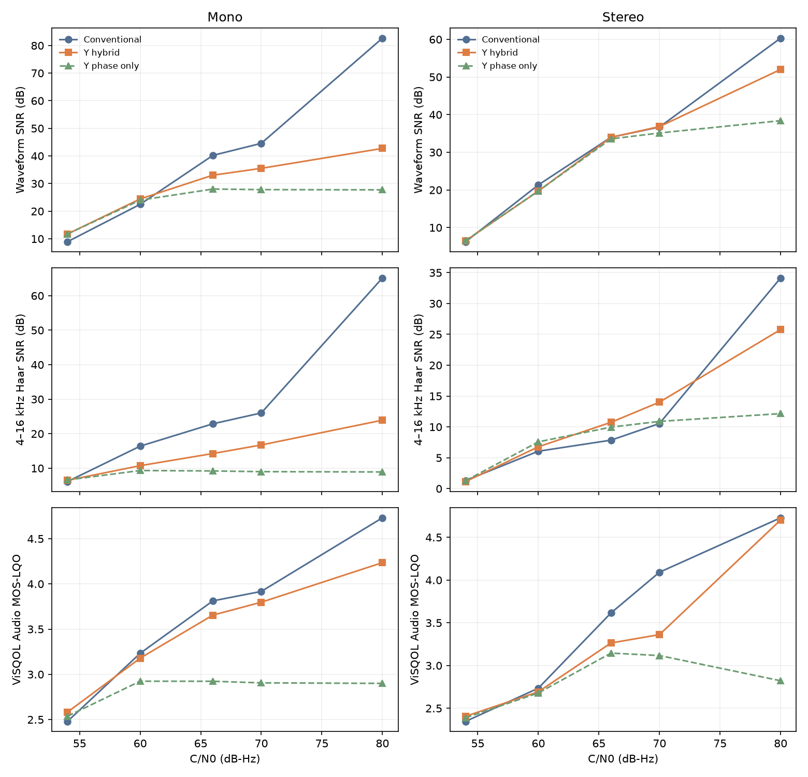

# GraceFM Y系の音質評価

## 評価方法

同じ10秒の原音、同じC/N0、同じ乱数種1を使い、保存した24 bit FLACを読み戻して比較する。ソフトウェア復号器の任意ポストフィルタはMで有効、Sで無効とする。32 kHz放送は主系と副系を電力50:50で送信し、副系を半ブロックずらして帯域別に融合する。48 kHzモニターは主系1本を使う。AWGN、系統ごとに独立のレイリーフェージング、主系10 dB低下を評価し、32 kHzの短時間リンク評価では静的反射波の等化あり・なしも含める。同期済みシンボルを前提とするシミュレーションであり、実RF受信の測定ではない。

波形SNRは原音と復号音の差、低域・高域SNRは正規直交Haar係数の信号電力と誤差電力から計算する。ステレオでは `M=(L+R)/2`、`S=(L−R)/2` をそれぞれ評価し、高域Sのレベル差は `10 log10(P復号/P原音)` とする。ViSQOL Audio MOS-LQOは聴感品質の予測指標で、実際の被験者による評価点ではない。CRC失敗率とPLC使用率は通信路シミュレーションの統計から求める。

32 kHzの素材は Fishin、Vibe Ace、全帯域合成ステレオのdemo。FishinとVibe Aceはモノラル、demoはM/Sジョイントステレオである。48 kHzのFishinとVibe Aceは32 kHz原音を再標本化したもので、12〜24 kHzを含む評価には合成ステレオのdemoと専用の `hires_probe` を使う。試聴用ファイルと条件の一覧は[32 kHz音源](../samples/hybrid_y/README.md)と[48 kHz音源](../samples/monitor_y/README.md)に示す。

条件別の数値と音声のSHA-256は[32 kHz比較JSON](results/hybrid_y_vs_legacy.json)、[48 kHz比較JSON](results/monitor_y_vs_legacy.json)、[M/S成分JSON](results/y_stereo_components.json)、[12〜24 kHz試験JSON](results/monitor_y_hires_probe.json)、[半径分解能比較JSON](results/monitor_y_radius_precision.json)に保存する。評価スクリプトは `tools/compare_hybrid_y_samples.py`、`tools/compare_monitor_y_samples.py`、`tools/report_y_stereo_components.py`、`tools/eval_m700hy_radius_precision.py` である。

## 32 kHz放送音源

各セルは **対応する従来主系 → Y系** の順。波形・帯域別SNRの単位はdB、ViSQOLはMOS-LQO。AWGN条件は主系と副系の融合を含む。[全24条件](results/hybrid_y_vs_legacy.json)から、コーデック単体とAWGNの代表条件を示す。

| 素材 | 条件 | 波形SNR | 0〜4 kHz SNR | 4〜16 kHz SNR | ViSQOL |
|---|---|---:|---:|---:|---:|
| Fishin | コーデック | 83.89 → 52.22 | 87.9 → 87.9 | 71.8 → 38.0 | 4.732 → 4.723 |
| Fishin | AWGN 80 | 56.61 → 35.40 | 70.7 → 73.5 | 42.6 → 21.2 | 4.704 → 4.309 |
| Fishin | AWGN 66 | 33.23 → 25.68 | 39.6 → 43.2 | 20.2 → 11.6 | 3.978 → 3.684 |
| Fishin | AWGN 60 | 22.70 → 21.08 | 26.3 → 27.4 | 10.8 → 8.0 | 3.276 → 2.948 |
| Vibe Ace | コーデック | 90.88 → 67.00 | 91.9 → 91.8 | 72.8 → 42.1 | 4.731 → 4.627 |
| Vibe Ace | AWGN 80 | 69.27 → 49.51 | 75.2 → 78.1 | 45.7 → 24.7 | 4.723 → 4.325 |
| Vibe Ace | AWGN 66 | 44.10 → 38.82 | 46.1 → 49.7 | 23.5 → 14.3 | 3.826 → 3.338 |
| Vibe Ace | AWGN 60 | 30.85 → 30.29 | 32.0 → 32.4 | 12.2 → 9.6 | 2.252 → 2.169 |
| demo | コーデック | 60.26 → 64.95 | 78.8 → 78.9 | 34.5 → 39.3 | 4.730 → 4.732 |
| demo | AWGN 80 | 50.14 → 47.85 | 66.8 → 57.9 | 24.4 → 22.5 | 4.687 → 4.544 |
| demo | AWGN 66 | 32.81 → 33.56 | 49.1 → 41.4 | 7.1 → 8.5 | 3.116 → 2.740 |
| demo | AWGN 60 | 23.80 → 24.82 | 24.7 → 26.0 | 5.4 → 5.1 | 2.389 → 2.393 |

FishinとVibe AceではY系の4 kHz以下は概ね同等以上だが、高域の量子化と半径雑音が波形SNRを下げる。demoの66 dB-Hzは総合波形SNRが上がる一方で、0〜4 kHz SNRとViSQOLが下がった。総合SNRだけから音質が改善したとは判定できない。

| 素材 | 条件 | 波形SNR：従来 → Y | ViSQOL：従来 → Y |
|---|---|---:|---:|
| Fishin | レイリー 60 | 12.82 → 13.40 | 2.948 → 2.706 |
| Fishin | 主系−10 dB、66 | 17.22 → 17.83 | 2.747 → 2.398 |
| Vibe Ace | レイリー 60 | 15.35 → 16.07 | 2.114 → 2.087 |
| Vibe Ace | 主系−10 dB、66 | 29.17 → 29.22 | 2.087 → 1.996 |
| demo | レイリー 60 | 11.19 → 11.03 | 2.399 → 2.429 |
| demo | 主系−10 dB、66 | 26.32 → 26.32 | 2.272 → 2.228 |

demoのY系10秒音源について、主系AのCRC失敗率と最終出力のPLC使用率を示す。後者は副系を融合した後、両系統から復元できず外挿したサンプルの割合である。

| 条件 | 主系CRC失敗率 | PLC使用率 |
|---|---:|---:|
| AWGN 80 | 0.00% | 0.00% |
| AWGN 66 | 0.00% | 0.00% |
| AWGN 60 | 0.04% | 0.00% |
| AWGN 57 | 45.96% | 0.01% |
| AWGN 54 | 100.00% | 24.03% |
| レイリー 60 | 40.92% | 8.00% |
| 主系−10 dB、66 | 88.80% | 0.00% |

### 半径を使わない復元

高域Mの位相とFEC保護済み上位bitだけを使い、半径を中央値に固定した。[3秒・主系1本の評価](results/hybrid_eval.json)から、標準の連続半径復元との対を示す。各セルは **位相のみ → 連続半径あり**。

| Y主系 | C/N0 | 波形SNR [dB] | 4〜16 kHz SNR [dB] | ViSQOL |
|---|---:|---:|---:|---:|
| `B200MHY-A4` | 66 | 28.01 → 33.04 | 9.21 → 14.26 | 2.923 → 3.655 |
| `B200MHY-A4` | 80 | 27.73 → 42.74 | 8.92 → 23.93 | 2.900 → 4.236 |
| `B200HY-A4` | 66 | 33.56 → 33.96 | 9.96 → 10.75 | 3.145 → 3.264 |
| `B200HY-A4` | 80 | 38.40 → 52.01 | 12.15 → 25.78 | 2.822 → 4.702 |

半径が読めない場合も粗い位相情報で復元でき、半径が読める条件では高域精度が増す。この表は主系1本の3秒値であり、上の10秒・2系統融合の値と直接同じ母集団ではない。

## 48 kHzモニター音源

各セルは **対応する従来主系 → Y系** の順。demoは全帯域合成ステレオで、主系1本のAWGNを使う。[全24条件](results/monitor_y_vs_legacy.json)からdemoを示す。

| 主系の組 | 条件 | 波形SNR [dB] | 0〜6 kHz SNR [dB] | 6〜24 kHz SNR [dB] | ViSQOL |
|---|---|---:|---:|---:|---:|
| `M700` / `M700Y` | コーデック | 38.31 → 38.37 | 75.2 → 75.2 | 16.8 → 16.8 | 4.729 → 4.729 |
| `M700` / `M700Y` | AWGN 70 | 38.31 → 31.76 | 74.4 → 67.5 | 16.8 → 10.2 | 4.729 → 4.205 |
| `M700` / `M700Y` | AWGN 65 | 30.28 → 27.82 | 31.3 → 33.0 | 15.3 → 7.8 | 3.088 → 3.011 |
| `M700H` / `M700HY` | コーデック | 54.62 → 57.86 | 83.6 → 83.6 | 33.1 → 36.3 | 4.729 → 4.729 |
| `M700H` / `M700HY` | AWGN 80 | 48.30 → 42.45 | 78.6 → 65.0 | 26.7 → 20.9 | 4.729 → 4.713 |
| `M700H` / `M700HY` | AWGN 75 | 34.60 → 36.02 | 60.3 → 47.0 | 13.1 → 14.8 | 4.648 → 4.320 |
| `M700H` / `M700HY` | AWGN 70 | 29.15 → 30.78 | 54.0 → 40.8 | 7.6 → 9.7 | 4.185 → 3.326 |
| `M700H` / `M700HY` | AWGN 65 | 25.92 → 26.57 | 33.1 → 32.1 | 5.3 → 6.4 | 3.207 → 2.722 |

`M700HY` のdemoは75/70/65 dB-Hzで総合波形SNRが上がる一方、低域SNRとViSQOLが下がる。FishinとVibe AceのAWGN 80 dB-Hzでは総合波形SNRもそれぞれ49.32→37.13 dB、63.15→50.97 dBと下がった。高域の物理的な振幅SNRが8 bit分の精度に届かない条件では、シンボル数の削減だけで音質向上を主張できない。

`M700HY` のdemoはAWGN 65/70/75/80 dB-Hzで主系CRC失敗とPLC使用がいずれも0だった。高域Mの半径精度の低下は、この範囲では保護部のCRC失敗を増やしていない。

### M/S成分と高域Sのレベル

保存したdemoのM/Sを別々にHaar分解した。[成分別の全16条件](results/y_stereo_components.json)から、主要条件を示す。各セルは **従来 → Y**、Sレベル差は原音に対する値である。

| 主系の組 | 条件 | M低域SNR [dB] | S高域SNR [dB] | S高域レベル差 [dB] |
|---|---|---:|---:|---:|
| `B200H-A4` / `B200HY-A4` | コーデック | 84.52 → 84.84 | 38.93 → 38.93 | 0.00 → 0.00 |
| `B200H-A4` / `B200HY-A4` | AWGN 80 | 70.61 → 58.87 | 27.53 → 28.22 | 0.01 → 0.00 |
| `B200H-A4` / `B200HY-A4` | AWGN 66 | 53.15 → 44.18 | 9.45 → 9.34 | 0.62 → 0.58 |
| `M700H` / `M700HY` | コーデック | 87.23 → 87.26 | 36.28 → 36.28 | 0.00 → 0.00 |
| `M700H` / `M700HY` | AWGN 80 | 82.91 → 69.85 | 28.52 → 30.86 | 0.01 → 0.00 |
| `M700H` / `M700HY` | AWGN 70 | 63.53 → 46.63 | 9.21 → 9.54 | 0.54 → 0.54 |

高域Sの復号レベルはここに示した条件で従来主系とほぼ同じだった。一方、弱いQAM位置へ置いた低域Mの下位bitは、特に高C/N0でM低域SNRを下げる。これはY系ステレオの残る制約として扱う。

### 12〜24 kHz試験音源

48 kHzの合成ステレオ `hires_probe` は12〜24 kHzのM成分を含む。[試験JSON](results/monitor_y_hires_probe.json)のSNRは、全帯域と最高Haar帯域を分けて示す。各セルは **従来 → Y**。これは自然音源のハイレゾ録音ではない。

| 主系の組 | 条件 | 波形SNR [dB] | 12〜24 kHz SNR [dB] | ViSQOL |
|---|---|---:|---:|---:|
| `M700` / `M700Y` | コーデック | 37.96 → 38.40 | 22.08 → 22.55 | 4.680 → 4.709 |
| `M700` / `M700Y` | AWGN 70 | 37.95 → 23.71 | 22.07 → 8.55 | 4.679 → 4.134 |
| `M700H` / `M700HY` | コーデック | 46.46 → 51.36 | 30.60 → 36.18 | 4.684 → 4.714 |
| `M700H` / `M700HY` | AWGN 80 | 41.54 → 33.60 | 25.85 → 18.42 | 4.595 → 4.444 |
| `M700H` / `M700HY` | AWGN 70 | 21.62 → 24.65 | 5.99 → 9.73 | 4.045 → 4.193 |

### 高域M半径の分解能

`M700HY` の高域M仮数を8、10、12 bitに設定した。高域Mは各幅で48シンボル/フレーム、総346シンボル/フレームである。次の値は保存した10秒FLACの波形SNR [dB]で、[半径分解能比較JSON](results/monitor_y_radius_precision.json)には最高帯域SNR、ViSQOL、ハッシュも保存する。

| 素材・条件 | 8 bit | 10 bit | 12 bit |
|---|---:|---:|---:|
| demo・コーデック | 57.86 | 60.57 | 60.82 |
| demo・AWGN 80 | 42.45 | 42.89 | 43.00 |
| demo・AWGN 70 | 30.78 | 30.78 | 30.79 |
| hires_probe・コーデック | 51.36 | 59.02 | 60.65 |
| hires_probe・AWGN 80 | 33.60 | 34.04 | 34.14 |
| hires_probe・AWGN 70 | 24.65 | 24.68 | 24.69 |

10/12 bitはコーデック単体の量子化誤差を減らすが、このAWGN条件では半径雑音が支配的で、無線往復の改善は小さい。半径幅は同じ最大変調度を保つよう調整しており、追加シンボルやFEC削減による差ではない。

## 静的反射波

各3秒の主系1本に5 µs・−10 dB・位相π/3の反射波を加え、送受信RRCの等価応答を通した。50フレームで既存の線形等化器を較正し、その区間をSNRから除いた。[短時間リンク評価JSON](results/hybrid_eval.json)の波形SNRを示す。表の全条件でCRC失敗は0フレーム、PLC使用率は0%だった。

| 主系 | 66 dB-Hz・等化なし | 66 dB-Hz・等化あり | 80 dB-Hz・等化なし | 80 dB-Hz・等化あり |
|---|---:|---:|---:|---:|
| `B200MH-A4` | 24.55 | 39.96 | 39.62 | 77.75 |
| `B200MHY-A4` | 28.68 | 32.94 | 30.24 | 42.64 |
| `B200H-A4` | 28.66 | 33.85 | 32.65 | 58.84 |
| `B200HY-A4` | 28.22 | 33.73 | 31.83 | 51.14 |

等化は両方式に効果があるが、高C/N0の最終SNRは高域の半径雑音と量子化幅にも制限される。反射波と搬送波の位相・時刻同期を理想化した結果であり、移動受信の保証ではない。

## 解釈上の制約

高域Mの半径成分は受信SNRに応じた連続値であり、下位bitのBERだけでは品質を表せない。コーデック単体のSNR、AWGN下のSNR、ViSQOL、位相のみの復元を分けて確認する。高域Sの量子化はY系と対応する従来主系で共通だが、無線のビット位置は異なるため、雑音下のSNRも個別に測る。放送主系と副系は別周波数であり、ここに示す音質値は2系統の受信処理を含む。

## 結論

Y系は高域Mを1係数/シンボルで送り、FEC保護を維持したまま主系の占有帯域を縮める。一方、10秒の保存音声ではモノラル素材の高域と、ステレオの低域Mおよび一部のViSQOLが従来方式より悪い。高域Sのレベルは同条件の従来方式とほぼ一致した。ステレオは `B200H-A4` と `M700H` を現行の選択とし、`B200HY-A4` と `M700HY` は帯域削減の実験用とする。8 bitから10/12 bitへの半径分解能の増加はコーデック単体には効くが、試したAWGN条件では小さな改善にとどまる。試聴音源は比較可能な形で保存したが、被験者による聴感試験は未実施である。
