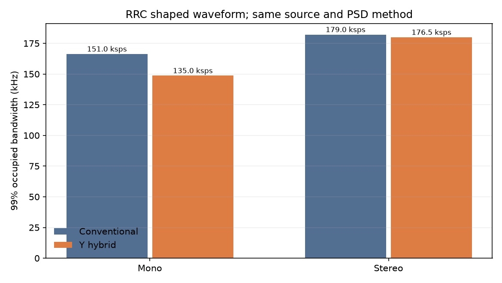

# GraceFM Y系：高域位相・連続振幅ハイブリッド変調

## 要旨

GraceFM Y系は、低域とS成分をデジタル変調で送り、高域M成分のHaar係数を1係数あたり1複素シンボルで送る実験用主系である。高域M仮数の上位2 bitを4位相、残りを連続半径に割り当てる。指数、区間アッテネータ、仮数上位bitのCRCと畳み込み符号による保護を維持し、半径から得る下位精度は受信品質に従って変化する。32 kHz版の主系レートはモノラル135.0 ksym/s、ステレオ176.5 ksym/s、48 kHz版は `M700Y` 443.25 ksym/s、`M700HY` 259.5 ksym/sとなる。これらはフレーム構成から求めた値であり、波形成形後の占有帯域は別途測定する。

## 1. 係数と量子化

入力は64サンプル/フレームのM/S信号とし、各成分に6段Haar変換を適用する。対象は32 kHzで4〜16 kHz、48 kHzで6〜24 kHzのM成分、計48係数/フレームである。高域M仮数の標準幅は8 bit。32 kHz Y主系はさらに、Mの4〜8 kHzを2係数ずつ、8〜16 kHzを4係数ずつ区切り、各帯域に8 bitの区間アッテネータを送る。Sは全帯域を送信し、対応する従来主系と同じ仮数幅、指数、区間アッテネータを使う。

高域Mの符号付き仮数を `m`、幅を `b` とすると、変調用の符号は `u = m + 2^(b−1)`、`H = floor(u / 2^(b−2))`、`L = u mod 2^(b−2)` とする。標準8 bitでは `H` が2 bit、`L` が6 bitである。送信点は次式で与える。

`s = [1 + a(L − (2^(b−2)−1)/2)] exp{j(π/4 + Hπ/2)} / C`

`C` は全符号を等確率とした平均シンボル電力を1にする係数である。標準設定の `a = 0.019047619…` は正規化前の半径を0.4〜1.6にする。10 bitと12 bitの評価設定はこの半径範囲を保ったまま符号間隔を細かくする。半径の下位成分はアナログ値として推定し、整数の下位bit列への硬判定を必須としない。

## 2. フレーム、保護、配置

1フレームは16シンボルのプリアンブル、デジタル部、高域Mの48シンボルからなる。デジタル部にはヘッダ、指数、区間アッテネータ、仮数上位bit、CRC-16を畳み込み符号（K=7、r=1/2）で保護して置き、低域MとSの残りの仮数bitを続ける。高域MのFEC済み上位bitは高域シンボルの位相にも重複して存在する。受信時はFEC側の値で位相候補を制約する。`M700Y` は元のQPSK主系と同じ上位2 bit、それ以外のY主系は上位1 bitをFECで保護する。

FEC後のビット列はデジタル部の先頭にあり、QPSKではI/Qの各bit、階層16QAMではI/Qの符号を決める強い位置に送る。CRCとパリティも通常QAM部の容量を使い、高域Mの48シンボルにはFECパリティを置かない。例えば `B200HY-A4` はプリアンブル16、階層16QAM 289、高域M 48シンボルで構成され、FEC後の492 bitは階層16QAM先頭246シンボルのI/Q符号位置を占める。残りのデジタル仮数bitは空いた符号位置と振幅位置に配置する。

階層16QAMの `B200HY-A4` と `M700HY` は、高域SのFEC直下のbitを強い象限位置へ置く。低域Mの一部の下位bitと、Sのそれ以外の非FEC bitは弱い位置へ置く。この順序は固定で、M/Sの量子化値自体を変えない。`B200HY-A4` の基本層境界は M `(12,11,5,3,1,2,2)`、S `(1,1,1,1,1,2,2)`、`M700HY` は M `(11,10,5,4,3,3,2)`、S `(1,1,1,1,1,2,2)` である。高域Mは専用シンボルへ移るため、この表の高域M基本層幅はデジタル配置に使わない。

デジタル部は既存のPRBSでスクランブルする。高域シンボルは同じPRBSから2 bitの位相マスクと1 bitの半径反転マスクを得る。反転は `L → 2^(b−2)−1−L` であり、連続半径の順序を保つ。実験用Y主系のAES-CTR暗号化はサポートせず、指定時に送受信機が明示的にエラーを返す。

| 主系 | 保護前（CRC除く） | CRC込み | FEC後 | デジタル非保護bit | デジタルシンボル | 高域Mシンボル | 総シンボル/フレーム | シンボルレート |
|---|---:|---:|---:|---:|---:|---:|---:|---:|
| `B200MHY-A4` | 124 | 140 | 292 | 240 | 206 | 48 | 270 | 135.0 ksym/s |
| `B200HY-A4` | 224 | 240 | 492 | 588 | 289 | 48 | 353 | 176.5 ksym/s |
| `M700Y` | 336 | 352 | 716 | 337 | 527 | 48 | 591 | 443.25 ksym/s |
| `M700HY` | 208 | 224 | 460 | 635 | 282 | 48 | 346 | 259.5 ksym/s |

総シンボル数には16シンボルのプリアンブルを含む。参照主系の総数は `B200MH-A4` 302、`B200H-A4` 358、`M700` 671、`M700H` 366である。副系 `S50M` と `S100` のフレームはY系でも同じである。32 kHzの半ブロックずらしと帯域別逆分散融合も同じ手順を使う。

## 3. 受信と実装範囲

高域Mの位相候補をFEC保護済みbitで制限し、選んだ位相を除去した半径座標から仮数の連続値を求める。プリアンブルと接線方向の残差から雑音分散を見積もり、半径の信頼度が下がると推定値を粗い位相情報へ近づける。高域係数の分散は低域/Sと同じ帯域別融合へ渡す。CRCが失敗したフレームは既存の欠落処理に従う。

送信フレームと基本復号手順にポストフィルタは含めない。リファレンスのソフトウェア復号器はMに任意のポストフィルタを適用できる。Sは軟復号した係数をそのまま逆Haar変換する。

## 4. 評価条件と再現

理論支持幅はシンボルレート `Rs` とRRCロールオフ `β` から `(1+β)Rs` として計算する。99%占有帯域、−30 dB帯域、PAPRは、送信シンボルを8倍標本化のRRCで波形成形し、Welch法（4096点）で得たスペクトルから測る。波形はシミュレーションであり、実RF測定や法令適合試験ではない。32 kHz主系と副系は別周波数なので、帯域を単純加算して単一の連続占有幅と解釈しない。

音質は保存した10秒FLACを原音と比較し、波形SNR、Haarの低域/高域SNR、M/S成分SNR、ViSQOL Audio MOS-LQO、CRC失敗率、PLC使用率を報告する。ViSQOLは予測指標であり、主観聴取試験の代用ではない。32 kHzは従来のAWGN、レイリーフェージング、主系10 dB低下、2周波数融合と同条件。48 kHzモニターは単一主系のAWGNを評価する。静的反射波は送受信RRCの等価通信路と既存等化器で評価する。いずれもシンボル時刻と搬送波位相の同期を理想とする。

再現用の入口は `python tools/eval_hybrid.py --seconds 3`、`python tools/make_hybrid_y_samples.py`、`python tools/make_monitor_y_samples.py`、`python tools/make_hires_y_probe.py`、`python tools/eval_m700hy_radius_precision.py` である。条件別の測定値は[32 kHzフレーム・通信路評価](results/hybrid_eval.json)、[32 kHz試聴音源](results/hybrid_y_samples.json)、[48 kHz試聴音源](results/monitor_y_samples.json)、[12〜24 kHz試験音源](results/monitor_y_hires_probe.json)、[半径分解能比較](results/monitor_y_radius_precision.json)に保存する。対応する音声は[32 kHz](../samples/hybrid_y/README.md)と[48 kHz](../samples/monitor_y/README.md)から再生できる。

## 5. 波形成形後の帯域と瞬時電力

32 kHzはFishin（モノラル）とdemo（ステレオ）、48 kHzはdemoの各3秒を用いた。理論支持幅と実測99%幅を区別して示す。測定値は[32 kHz評価JSON](results/hybrid_eval.json)と[48 kHz音源JSON](results/monitor_y_samples.json)のスペクトルから転記した。

| 主系 | シンボルレート [ksym/s] | RRC理論支持幅 [kHz] | 99%占有帯域 [kHz] | −30 dB幅 [kHz] | PAPR [dB] |
|---|---:|---:|---:|---:|---:|
| `B200MH-A4` | 151.00 | 188.75 | 166.34 | 188.75 | 5.85 |
| `B200MHY-A4` | 135.00 | 168.75 | 148.71 | 168.49 | 7.42 |
| `B200H-A4` | 179.00 | 196.90 | 182.15 | 197.18 | 7.16 |
| `B200HY-A4` | 176.50 | 194.15 | 179.95 | 194.43 | 8.59 |
| `M700` | 503.25 | 629.06 | 553.38 | 629.06 | 4.99 |
| `M700Y` | 443.25 | 554.06 | 489.13 | 554.06 | 7.21 |
| `M700H` | 274.50 | 343.13 | 302.38 | 342.05 | 5.88 |
| `M700HY` | 259.50 | 324.38 | 286.87 | 323.36 | 7.26 |

99%占有帯域の削減は対応する主系に対してモノラル放送10.6%、ステレオ放送1.2%、`M700Y` 11.6%、`M700HY` 5.1%である。高域Mの半径変調によりPAPRは各組合せで上がる。ここでの−30 dB幅は有限長RRC波形のWelchスペクトルを最大PSDから30 dB以内で切った両端の差であり、法規上の占有帯域の判定値ではない。

### 設定感度

次の感度分析は32 kHzのFishin（モノラル）とdemo（ステレオ）の各3秒、**主系1本・AWGN 66 dB-Hz**で行った。数値は[評価JSON](results/hybrid_eval.json)の条件をそのまま示す。

| 高域Mの開始帯域 | モノラル：総シンボル / 99%幅 / 波形SNR | ステレオ：総シンボル / 99%幅 / 波形SNR |
|---|---|---|
| 2 kHz | 250 / 137.70 kHz / 31.07 dB | 361 / 184.03 kHz / 34.32 dB |
| 4 kHz（標準） | 270 / 148.71 kHz / 33.04 dB | 353 / 179.95 kHz / 33.96 dB |
| 8 kHz | 294 / 161.93 kHz / 36.55 dB | 345 / 175.53 kHz / 33.80 dB |

| 高域M仮数幅 | モノラル波形SNR | ステレオ波形SNR |
|---|---:|---:|
| 8 bit（標準） | 33.04 dB | 33.96 dB |
| 10 bit | 33.16 dB | 33.99 dB |
| 12 bit | 33.08 dB | 33.99 dB |

仮数幅を変えても高域Mの係数数、FECの保護量、シンボル数は同じである。このAWGN条件では半径の雑音が主で、10/12 bit化による波形SNRの差は小さい。

| 半径設定 `amplitude` | モノラル：波形SNR / PAPR | ステレオ：波形SNR / PAPR |
|---|---|---|
| 0.04 | 30.71 / 6.22 dB | 33.06 / 7.61 dB |
| 0.08（標準） | 33.04 / 7.42 dB | 33.96 / 8.59 dB |
| 0.12 | 32.37 / 8.29 dB | 33.17 / 9.42 dB |

`amplitude` は6 bitを基準にした半径間隔の指定値で、8/10/12 bitでは同じ半径範囲になるよう内部で換算する。変調度を大きくするとPAPRも上がり、音源と条件によって波形SNRの改善は単調ではない。

## 6. 制約

半径は発振器の位相雑音、利得推定誤差、残留ISIでも乱れる。これらをAWGNの半径雑音と同一視しない。半径幅を10/12 bitに広げても物理的な振幅SNRが同じなら有効精度が同じとは限らない。送信瞬時電力、PAPR、帯域外漏洩と適用先の出力制限は別途照合する必要がある。48 kHzの自然音源は32 kHz原音の再標本化も含み、12〜24 kHzの評価には合成ステレオ試験音源を併用する。

## 7. 結論

高域Mの48係数を各1シンボルへ載せ、FEC保護済み上位bitを残したまま、4主系すべてでシンボルレートと測定99%占有帯域を削減できた。32 kHzステレオの削減は1.2%と小さい。Y系ではPAPRが上がり、受信条件と素材によって高域や低域MのSNR、ViSQOLが従来主系を下回る。この評価条件では、ステレオの現行選択は `B200H-A4` と `M700H` とし、`B200HY-A4` と `M700HY` は帯域削減の実験用として扱う。現段階の結果は無線幅の削減と音質維持の両立を全条件で示すものではない。条件別の音質、位相のみの基準、M/S成分と半径分解能は[音質評価報告](HYBRID_Y_AUDIO_QUALITY.md)に示す。
