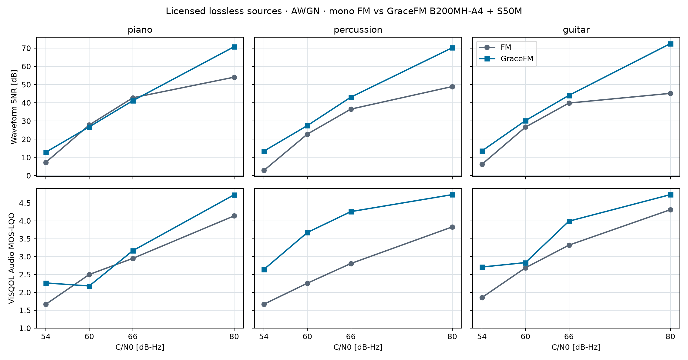

# 音質ベンチマーク：ロスレス音源、波形SNR、ViSQOL Audio

モノラル主系 `B200MH-A4` の音質を、コーデック単体と通信路込みの二条件で評価する。波形SNRは原音との差の総電力、[ViSQOL Audio MOS-LQO](https://github.com/google/visqol) は聴感品質の予測値で、大きいほど良い。ViSQOL は実際の聴取試験の MOS ではない。コーデック単体ではMP3、通信路込みではアナログFMを比較対象とする。

## 評価音源と方法

評価音源はWikimedia Commonsで公開されているPCM WAVである。ピアノと打楽器は **CC0 1.0**、ギターは作者 GioMilko が公開した **CC BY 4.0**。ギターの作者・録音条件・ライセンスは[元の Freesound ページ](https://freesound.org/people/GioMilko/sounds/344211/)でも確認できる。評価用WAVの同一性は公開元のメタデータとSHA-256で確認する。音声本体は評価資料に含めず、出典・形式・ハッシュと測定値を結果JSONに記録する。

| 評価名 | 音源 | 原音の形式・ライセンス | 用途 |
|---|---|---|---|
| piano | [Emotional piano.wav](https://commons.wikimedia.org/wiki/File:Emotional_piano.wav) | 44.1kHz・ステレオ・PCM 16bit、CC0 1.0 | ピアノ |
| percussion | [Ceramic Djembe.wav](https://commons.wikimedia.org/wiki/File:Ceramic_Djembe.wav) | 96kHz・ステレオ・PCM 16bit、CC0 1.0 | 打楽器 |
| guitar | [C Major 9 Bossa Nova Guitar by GioMilko](https://freesound.org/people/GioMilko/sounds/344211/) | 48kHz・モノラル・PCM 24bit、CC BY 4.0 | ギターの演奏 |

ギター音源のクレジット：**“C Major 9 Bossa Nova Guitar” by GioMilko**, [CC BY 4.0](https://creativecommons.org/licenses/by/4.0/)。

各ファイルの **1〜6秒**をモノラル化し、32kHz に変換してピークを0.89に揃えた。評価区間は各5秒。波形SNR は32kHzで測り、ViSQOL Audio は原音・出力を同じ方法で48kHzへ再標本化して測った。実装は `visqol-python` 3.8.0。モノラル入力は左右に同一信号を与えた。C/N0 は180kHz の雑音帯域で表示し、通信路は同期・等化済みのシンボルに雑音を加えるモデル、乱数 seed は1である。

```sh
pip install -r requirements-eval.txt
python tools/fetch_lossless_benchmark_audio.py
python tools/eval_lossless_benchmark.py --json docs/results/lossless_benchmark.json
python tools/eval_lossless_benchmark.py --channels rayleigh,fade10 --cn0 60,66 --skip-codec --json docs/results/lossless_impairments.json
python tools/fig_lossless_benchmark.py
```

条件別の測定値、音源のハッシュ、評価条件は [`lossless_benchmark.json`](results/lossless_benchmark.json) と [`lossless_impairments.json`](results/lossless_impairments.json) に記録した。評価用の音源ファイルはリポジトリに含めず、公開元から取得する。

## コーデック単体：MP3 との比較

GraceFM は B200MH-A4 の全ビット（音声ペイロード **474kbps**）。MP3 は [FFmpeg/libmp3lame](https://ffmpeg.org/ffmpeg-codecs.html#libmp3lame) の CBR 128・192・320kbps を符号化・復号し、ギャップレス情報を反映した。無線路、FEC、ヘッダ、ガード帯域はどちらにも含めない。表は **波形SNR [dB] / ViSQOL MOS-LQO**。

| 素材 | GraceFM 474kbps | MP3 128kbps | MP3 192kbps | MP3 320kbps |
|---|---:|---:|---:|---:|
| piano | 89.72 / 4.732 | 26.02 / 4.728 | 30.47 / 4.731 | 67.94 / 4.731 |
| percussion | 91.13 / 4.732 | 25.96 / 4.683 | 30.42 / 4.695 | 53.72 / 4.694 |
| guitar | 91.16 / 4.732 | 25.96 / 4.518 | 30.46 / 4.526 | 66.00 / 4.526 |

GraceFM は3素材とも波形SNRで上回ったが、音声レートも高い。ViSQOL は全方式が高品質域で 4.7 前後に集まり、この表だけで高品質域の聴感上の優劣は決められない。

## 通信路込み：同じ C/N0 の FM と比較

GraceFM は `B200MH-A4`（主系）＋`S50M`（副系）、送信電力50:50。音声ペイロードは主系474＋副系45.5 = **519.5kbps**、無線総レートは主系604＋副系118 = **722kbps**。FM はモノラル、±75kHz、50µs プリエンファシス、IF ±100kHz と遅延検波。表は白色雑音条件の **波形SNR [dB] / ViSQOL MOS-LQO**。PLC は両系統が欠けて補間した時間の割合。



| 素材 | C/N0 [dB-Hz] | FM SNR / ViSQOL | GraceFM SNR / ViSQOL | PLC |
|---|---:|---:|---:|---:|
| piano | 54 | 7.25 / 1.665 | 12.84 / 2.262 | 0.24% |
| piano | 60 | 27.78 / 2.499 | 26.76 / 2.178 | 0.00% |
| piano | 66 | 42.70 / 2.948 | 41.10 / 3.163 | 0.00% |
| piano | 80 | 54.03 / 4.138 | 70.76 / 4.728 | 0.00% |
| percussion | 54 | 2.82 / 1.667 | 13.42 / 2.639 | 0.32% |
| percussion | 60 | 22.77 / 2.255 | 27.46 / 3.673 | 0.00% |
| percussion | 66 | 36.49 / 2.805 | 43.06 / 4.256 | 0.00% |
| percussion | 80 | 48.89 / 3.829 | 70.20 / 4.731 | 0.00% |
| guitar | 54 | 6.21 / 1.855 | 13.55 / 2.707 | 0.12% |
| guitar | 60 | 26.62 / 2.686 | 30.19 / 2.831 | 0.00% |
| guitar | 66 | 39.82 / 3.319 | 44.05 / 3.989 | 0.00% |
| guitar | 80 | 45.14 / 4.310 | 72.45 / 4.731 | 0.00% |

54・80dB-Hz では3素材とも GraceFM の両指標が高い。60・66dB-Hz ではピアノのように FM が一部の指標で高く、素材によって優劣が分かれる。波形SNRの順位と ViSQOL の順位も常に一致しない。

### フェージングと主系 −10dB

同じ3素材の同じ5秒区間を用いた。レイリーフェージングでは主系・副系に独立の電力変動（時定数約100ms）を与え、FM の搬送波にも同じモデルを適用した。主系 −10dB では GraceFM の主系と FM の搬送波だけを10dB落とし、副系は元の電力とする。表は **波形SNR [dB] / ViSQOL MOS-LQO**。

| 素材 | 通信路 | C/N0 [dB-Hz] | FM SNR / ViSQOL | GraceFM SNR / ViSQOL | PLC |
|---|---|---:|---:|---:|---:|
| piano | レイリー | 60 | 7.57 / 1.923 | 12.37 / 1.997 | 3.78% |
| piano | レイリー | 66 | 13.15 / 2.317 | 25.31 / 2.505 | 0.12% |
| percussion | レイリー | 60 | 3.94 / 1.931 | 16.26 / 3.102 | 3.64% |
| percussion | レイリー | 66 | 9.36 / 2.132 | 29.23 / 3.793 | 0.16% |
| guitar | レイリー | 60 | 6.62 / 2.076 | 14.48 / 2.486 | 3.52% |
| guitar | レイリー | 66 | 12.10 / 2.463 | 25.97 / 3.024 | 0.16% |
| piano | 主系 −10dB | 60 | 1.79 / 1.599 | 23.32 / 2.439 | 0.00% |
| piano | 主系 −10dB | 66 | 12.02 / 2.058 | 24.66 / 1.812 | 0.00% |
| percussion | 主系 −10dB | 60 | -2.14 / 1.000 | 25.65 / 2.723 | 0.00% |
| percussion | 主系 −10dB | 66 | 7.25 / 1.740 | 28.52 / 3.105 | 0.00% |
| guitar | 主系 −10dB | 60 | 0.90 / 1.764 | 27.96 / 2.993 | 0.00% |
| guitar | 主系 −10dB | 66 | 10.76 / 2.143 | 29.35 / 2.421 | 0.00% |

この12条件では波形SNRはすべて GraceFM が高い。ViSQOL はピアノの主系 −10dB・66dB-Hz のみ FM の方が高い。PLC はレイリー60dB-Hzで約3.5〜3.8%だった。

## 解釈上の限界

- 3音源の各5秒、単一の乱数 seed による評価である。ジャンル全体や聴取者全体の平均は表さない。
- ViSQOL は高品質のコーデック出力で上限付近に張り付く。特に MP3 と GraceFM の聴感差をこの点数の小数第3位で判断しない。
- 32kHz への変換後は16kHzより上の原音成分を比較しない。原音はロスレスだが、方式の音声帯域を越える部分は評価対象外である。
- 無線路は同期・等化と受信電力のモデルで、実 RF・マルチパス等化・FM ステレオを含まない。FM と GraceFM の絶対的な主観品質を確認するにはブラインド聴取試験が必要である。
