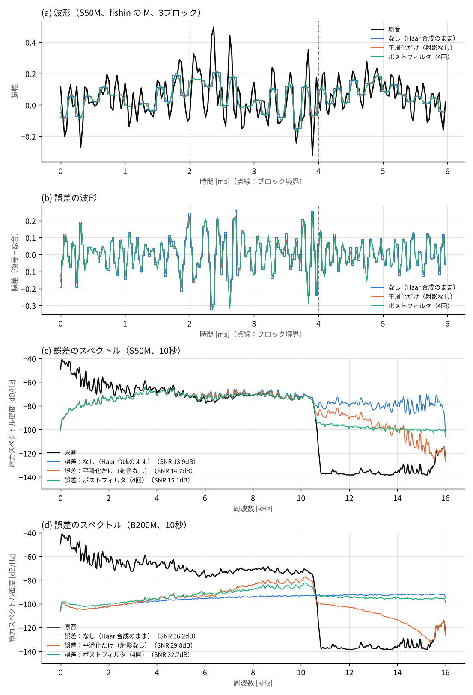
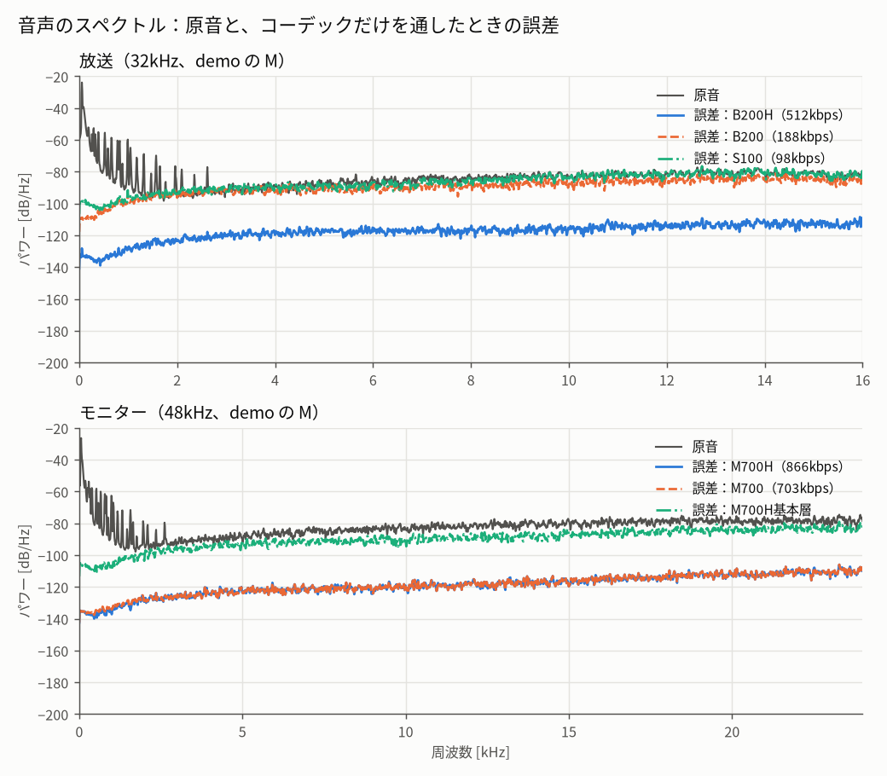

# GraceFM：FM帯における低遅延かつなだらかに劣化するデジタル音声伝送方式

リファレンス実装：`gracefm`

## 概要

FM帯で音声を理想時刻モデルの伝送遅延4.0ms（処理時間・フィルタ遅延を除く）で送り、受信電力の低下に対して音質がなだらかに下がるデジタル伝送方式 GraceFM を提案する。符号化は各チャンネル64サンプルを1フレームとする6段 Haar 分解を用い、6つの詳細帯域と1つの低域近似成分をブロック浮動小数点で量子化する。モノラル主系 `B200MH-A4` は最高域を4係数ずつ8区間に分けるアッテネータ8bitを持つ。ステレオ主系 `B200H-A4` も M/S ジョイントステレオの最高域に区間アッテネータを持ち、M は8係数ずつ4区間、S は4係数ずつ8区間で計12bitである。両主系とも帯域ごとの指数4bitと固定オフセットを用い、指数・アッテネータ・仮数上位1bitを畳み込み符号とフレームCRC-16で保護する。主系の階層16QAMは基本層と拡張層を載せ、低ビットレートの副系を別周波数で半ブロックずらして送る。受信側はビットの事後確率から仮数の期待値を求め、2系統を Haar 帯域ごとの逆分散重みで融合し、両系統とも欠けた区間だけ LPC で外挿する。公開ライセンスのロスレス PCM WAV 3素材を用いたモノラル評価では、C/N0 54dB-Hz で本方式の波形SNRは12.84〜13.55dB（同じ受信電力のモノラルFMは2.82〜7.25dB）、80dB-Hz では70.20〜72.45dB（FMは45.14〜54.03dB）だった。聴感寄りの ViSQOL は中間の受信条件で素材によって順位が分かれ、方式の主観的な優劣はこの指標だけで断定しない。静的な反射波1本を送受信 RRC とともに評価すると、80dB-Hz の反射波あり21条件で11タップの線形等化器はFMより波形SNRが9.37〜25.84dB高かった。一方、66dB-Hz の21条件では波形SNRの優位は18条件に限られ、フィルタと等化器を含む定常伝送遅延の下限はモノラル放送で4.339msとなる。

**表1　主要仕様**

| 項目 | 放送（FM放送の代替・災害時） | モニター（据え置き機・近距離） |
|---|---|---|
| 構成 | 主系 B200H-A4 / B200MH-A4 ＋ 副系 S100 / S50M | M700H |
| 伝送遅延（処理時間・フィルタ遅延0） | 4.00ms | 2.67ms |
| サンプリング / 音声帯域 | 32kHz / 16kHz | 48kHz / 24kHz |
| 音声ビットレート | 主系 536 / 474kbps（基本層 206 / 198）＋ 副系 95 / 46kbps | 854kbps（基本層 329） |
| 変調 | 主系 階層16QAM（α=5）、副系 QPSK | 階層16QAM（α=5） |
| 誤り訂正 | 指数・仮数上位1bit・主系の区間アッテネータ：畳み込み符号（K=7, r=1/2）＋フレームCRC-16 | 指数・仮数上位1bit（同左） |
| 占有帯域（99%） | 主系 182 / 167kHz＋ 副系 104 / 65kHz | 302kHz |
| 冗長性 | 2周波数、格子を半ブロックずらし帯域ごとに逆分散重みで融合 | なし |
| 欠落時 | 片方の欠落は他方で補う。両方欠けたら LPC で外挿（30ms まで） | LPC で外挿（30ms まで） |
| 暗号化 | AES-128-CTR（任意。本文の放送評価では無効） | AES-128-CTR（任意） |

**表2　モノラル放送構成の主要性能**（公開ライセンスのロスレス3素材、同じ受信電力、白色雑音。波形SNR [dB] / ViSQOL MOS-LQO）

| 素材 | C/N0 | GraceFM B200MH-A4＋S50M | アナログFM |
|---|---:|---:|---:|
| ピアノ | 54dB-Hz | 12.84 / 2.262 | 7.25 / 1.665 |
| ピアノ | 80dB-Hz | 70.76 / 4.728 | 54.03 / 4.138 |
| 打楽器 | 54dB-Hz | 13.42 / 2.639 | 2.82 / 1.667 |
| 打楽器 | 80dB-Hz | 70.20 / 4.731 | 48.89 / 3.829 |
| ギター | 54dB-Hz | 13.55 / 2.707 | 6.21 / 1.855 |
| ギター | 80dB-Hz | 72.45 / 4.731 | 45.14 / 4.310 |

全C/N0条件、コーデック単体のMP3比較、音源の出典とハッシュは[音質ベンチマーク](QUALITY_BENCHMARK.md)に示す。フェージングと片方の周波数の電力低下も同じ音源で評価した。

---

## 1. はじめに

本方式はFM帯での低遅延音声伝送を対象とする。受信電力の低下時に音声品質を段階的に保ち、フレーム欠落から短時間で復帰することを設計要件とする。アナログFMを同じ受信電力での比較対象とする。

本稿の貢献は次の5点である。

1. 遅延をブロック長の2倍に抑えつつ、ビット誤りを雑音として受け入れる符号化とフレーム構成（3.2〜3.3節）
2. 受信電力に応じて量子化精度が連続的に変わる階層16QAM の層構成（3.4節）
3. 受信を、Haar 係数を状態とする推定問題（広義のカルマンフィルタ）として組み立てた受信処理：軟判定の観測、量子化区間への射影による量子化雑音の除去、2系統の逆分散重みによる融合（センサフュージョン）、欠落時の予測（3.6節）
4. 低ビットレートの副系を別の周波数で送る2系統構成（3.5節）
5. 同じ受信電力でのアナログFMとの定量比較、フレーム欠落の評価（5節）

## 2. 関連技術

| 技術 | 本方式との関係 |
|---|---|
| 階層変調（DVB-T [3]）・重ね合わせ符号化 [2] | 強い位置に重要なビットを置く考え方。本方式は仮数の上位・下位ビットに対応させる |
| SoftCast [1] | 誤りに応じて品質がなだらかに変わる伝送。本方式はデジタル符号化のまま、事後確率による軟判定の復号で同様の性質を得る |
| アナログFM [4] | 比較対象。スレッショルドとマルチパス歪みを持つ |
| シフテッド補間 [5]・3次補間 [6]・凸集合への射影 [7] | 受信側ポストフィルタの平滑化と量子化区間への射影 |
| 畳み込み符号とビタビ復号 [8] | 保護部の誤り訂正 |
| カルマンフィルタ [13]・逆分散重みによるセンサフュージョン | 受信処理の枠組み。2系統の融合は2つの観測によるカルマンの更新 |
| 集合帰属推定（有界誤差の推定）[14] | 量子化区間を観測の制約として扱うポストフィルタ |
| 欠落補間（PLC）[15] | 両系統とも欠けた区間の外挿 |
| AES [11]・CTR モード [12] | 暗号化 |

## 3. 方式

### 3.1 全体構成

**図1　送受信の構成**

```text
送信：L/R（各64サンプル）→ M/S → Haar 6詳細帯域＋低域近似 → 指数・アッテネータ・仮数
      → 暗号化（任意）→ フレーム化・CRC・FEC → スクランブル → 変調
      → 主系 f1／半ブロックずらした副系 f2

受信：同期済みシンボルの軟判定 → デスクランブル → ビタビ復号・CRC検査
      → 復号成功時に復号済みビットを復号鍵で復元（暗号化時）
      → 仮数の事後平均・量子化区間 → Haar合成（Mの任意ポストフィルタ）
      → 2系統の帯域別融合 → 両系統欠落時のPLC
```

暗号化時はフレーム内の音声ビットを暗号化した後にCRCとFECを適用する。受信側はFECとCRCの検査を終えてから暗号を戻す。

### 3.2 音声符号化

1フレームは各チャンネル64サンプルで構成する。ステレオでは左右それぞれ64サンプル、すなわち64組のL/R入力を `M = (L+R)/2`、`S = (L−R)/2` に変換する。モノラルではMだけを符号化する。MとSそれぞれに正規直交Haar変換を6段適用し、6つの詳細帯域と1つの低域近似成分を得る（表3）。符号化に前後の音声フレームは使わない。32kHzでは1フレーム2.00ms、48kHzでは1.33msであり、副系の格子は32サンプルずれる。

**表3　Haar 6詳細帯域と低域近似成分の名目周波数範囲・係数数**

| 係数群 k | 0 | 1 | 2 | 3 | 4 | 5 | 6 |
|---|---|---|---|---|---|---|---|
| 種別 | 低域近似 | 詳細1 | 詳細2 | 詳細3 | 詳細4 | 詳細5 | 詳細6 |
| 32kHzの名目帯域 | 0〜250Hz | 250〜500Hz | 0.5〜1kHz | 1〜2kHz | 2〜4kHz | 4〜8kHz | 8〜16kHz |
| 48kHzの名目帯域 | 0〜375Hz | 375〜750Hz | 0.75〜1.5kHz | 1.5〜3kHz | 3〜6kHz | 6〜12kHz | 12〜24kHz |
| 係数の数 | 1 | 1 | 2 | 4 | 8 | 16 | 32 |
| 分解段数 lev(k) | 6 | 6 | 5 | 4 | 3 | 2 | 1 |

詳細帯域は6つである。低域近似成分も独立に量子化するため、実装の配列とフレーム内の指数・仮数の割り当ては `k=0…6` の7係数群を持つ。例えば全群を送るモノラル主系の指数は7個、各4bitで計28bitとなる。

係数群ごとに、仮数 `b` bit・共有指数4bitのブロック浮動小数点で量子化する。`qmax = 2^(b−1)−1`、指数の固定オフセットを `emin` とすると、フレームに格納する値は `eidx = e−emin`（0〜15）である。指数の範囲は `emin ≤ e ≤ emin+15`、仮数は `m = clip(round(c/2^e), −qmax, qmax)` とする。フレーム上の仮数はオフセットバイナリ `u = m+qmax` で表す。送受信機は同じ固定オフセットを使い、フレームごとのオフセット送信はない。指数の最大・最小ステップ比は `2^15`（約90dB）である。復元値は `m·2^e` であり、受信側の量子化区間は通常 `(m±1/2)·2^e` とする。最高域の区間アッテネータが1なら、これらの式の `2^e` を `2^(e−1)` に置き換える。飽和した仮数の区間は入力振幅の上限まで拡張する。帯域別の仮数幅は付録Bに示す。

モノラル主系 `B200MH-A4`（ID 14）では、低域近似 `k=0` と6詳細帯域 `k=1…6` の固定指数オフセットを順に `(-26, -26, -27, -27, -28, -27, -26)` とする。最高域の32係数を4係数ずつ8区間に分け、区間アッテネータが1のとき量子化ステップを `2^e` から `2^(e−1)` にする。アッテネータ8bitは指数の直後に配置し、指数・仮数上位ビットとともにフレーム単位のCRC-16と畳み込み符号で保護する。保護部は132bit/フレーム、主系シンボルレートは151ksymbol/sである。指数幅とアッテネータの量子化特性は5.8節に示す。

ステレオ主系 `B200H-A4`（ID 10）では、同じ64組のL/R入力から M と S を作り、それぞれの最高域32係数に区間アッテネータを置く。名称の `A4` は S 側の4係数区間を表し、M 側は8係数区間である。M は8係数×4区間、S は4係数×8区間で、合計12bit/フレームである。固定指数オフセットは M が `(-25,-25,-26,-23,-21,-18,-19)`、S が `(-23,-21,-21,-18,-18,-18,-19)`。指数幅4bitと仮数幅は M/S とも維持する。保護部は228bit/フレーム、主系シンボルレートは179ksymbol/sである。

### 3.3 フレームと誤り制御

1フレーム＝1ブロック：`[プリアンブル16シンボル][保護部の符号化ビット][非保護部]`

- **保護部**：ヘッダ（16bit）、指数（4bit×送信する係数群の数）、主系の区間アッテネータ（ステレオ12bit / モノラル8bit）、仮数の上位1bit、CRC-16-CCITT。畳み込み符号（K=7、r=1/2、133/171）で符号化し、フレームごとに終端する。CRC 不一致のフレームは欠落とする（3.6.6節）。
- **非保護部**：残りの仮数ビットを、仮数内の順位（上位から）→ M→S → 帯域 低→高 の順に並べる。訂正も検出もせず、受信品質に応じて仮数の精度が低下する。
- 階層化したプロファイルでは、基本層を並べてから拡張層を並べる。

フレームの詳細は付録C。

### 3.4 変調

Y系の高域M仮数は標準8bitとし、上位2bitを位相、下位6bitを連続半径へ割り当てる。仮数幅を変えても高域Mは1係数/1複素シンボルである。32kHzのY主系ではMの4〜8kHzを2係数ずつ8区間、8〜16kHzを4係数ずつ8区間に分け、各帯域に8bitの区間アッテネータを送る。この16bitも指数・仮数上位bitと同じCRC・畳み込み符号で保護する。Sの区間アッテネータ設定は対応する従来主系と同じである。

実験用の高域位相・振幅主系 `B200MHY-A4` / `B200HY-A4` / `M700Y` / `M700HY` は専用のフレーム配置を使う。高域Mの仮数を1係数/複素シンボルに載せ、FEC保護済み仮数上位bit（`M700Y` は2bit）を維持する。48kHz版はMの6〜24kHzを対象とする。Sの仮数幅・指数・区間アッテネータは対応する従来主系と共通である。階層16QAMのY主系は高域Sの次位bitを強い位置、低域Mの一部の下位bitを弱い位置へ配置する。方式、制約、シンボル予算、測定結果は[Y系の設計・評価報告](HYBRID_Y_PAPER.md)に記録する。

**階層16QAM。** 各軸の点を `±α, ±(α+2)` として正規化し、象限ビットに保護部と基本層、位置ビットに拡張層を割り当てる。α=5 では、判定境界までの距離は QPSK 比で象限ビット −1.7dB（内側）/ +1.2dB（外側）、位置ビット −15.7dB である。拡張層は、基本層のシンボル数のまま位置ビットを埋めるよう、各帯域の仮数を下位に1bitずつ延ばして作る（上限16bit）。本稿の主系ではα=5とする。

**スクランブル。** プリアンブル以外の全ビットを PRBS `1 + x^14 + x^15`（フレームごとに初期化）と XOR し、送信スペクトルの線スペクトルを除く（5.7節）。

送受信の波形にはルートレイズドコサイン（RRC）を用いる。B200H-A4 はロールオフ0.10・32シンボル長、その他のプロファイルはロールオフ0.25・16シンボル長とする。白色雑音・フェージングの基準評価は同期済みシンボルを直接扱い、静的マルチパス評価は送受信 RRC の合成応答をシンボル時刻で標本化した等価通信路を用いる。いずれもシンボル時刻と搬送波位相の再生は理想とする。

各フレームのプリアンブル16シンボルと、続くヘッダの符号化ビットを運ぶ16シンボルの象限を、伝搬路推定に用いる。後者を使うにはフレーム番号の追跡が必要である。QPSK ではヘッダのシンボル値全体が既知である。階層16QAM では保護部の象限だけが既知なので、訓練時の各軸振幅は信号点の平均値で近似する。ヘッダを32bitとする暗号化時は対応する先頭32シンボルの象限を使える。静的マルチパスのリファレンス受信器は、先行する100フレームの訓練シンボルで15タップの伝搬路を最小二乗推定し、その100フレームの判定結果だけで2回推定し直す。残差から雑音電力を推定し、先読み4シンボル以下の11タップ線形 MMSE FIR を設計する。ヘッダの検出・フレーム番号の取得と時刻同期は、この受信器の外部で与える。

### 3.5 2周波数構成

- 主系（B200H-A4 / B200MH-A4）と副系（S100 / S50M）を、数MHz以上離した2周波数で送る。
- 副系は入力の先頭に半ブロックの0を入れ、ブロックの格子を半ブロックずらす。
- 副系は低域中心の低ビットレート（S50M：4kHz まで 46kbps）で、シンボルレートが低い。送信電力 50:50 で、副系の Es/N0 は主系より 4.1dB（B200MH-A4＋S50M）/ 2.8dB（B200H-A4＋S100）高い。
- 静的反射波の位相は周波数間隔 Δf と遅延 τ により副系で `φsub = φmain − 2πΔfτ` となる。別周波数は落ち込みを分散させ得るが、`Δfτ` が整数なら反射波の位相は両系統でそろう。2周波数による独立フェージングは、周波数を離すだけでは保証されない。

### 3.6 受信：推定の枠組み

#### 3.6.1 推定問題としての定式化

受信側の処理を、送信した Haar 係数を状態とし、各系統の受信を雑音の大きさが分かった観測とする推定問題として組み立てる。軟判定の復号・ポストフィルタ・2系統の融合・欠落の補間は、いずれもこの枠組みの一部である（表4）。

**表4　カルマンフィルタ [13]（線形最小平均二乗誤差推定）の要素と本方式の対応**

| 要素 | 一般形 | 本方式 | 節 |
|---|---|---|---|
| 状態 x | 推定したい量 | 帯域 k の Haar 係数 c（M・S 別） | 3.6.1 |
| 観測 z_i | `z_i = x + v_i`、`v_i ~ (0, R_i)` | 系統 i の軟判定の係数（仮数の期待値×量子化ステップ） | 3.6.2 |
| 観測雑音の分散 R_i | 既知とする | ビットの事後確率と量子化ステップから係数ごとに計算 | 3.6.2 |
| 観測が与える制約 | — | 係数の取り得る区間 `c ∈ [lo, hi]`（量子化器の逆像） | 3.6.3 |
| 事前知識（予測） | 状態遷移モデル | 音声のなめらかさ（ポストフィルタ）／帯域ごとの AR(p)（任意）／時間領域の LPC（欠落時） | 3.6.3・3.6.5・3.6.6 |
| 観測の更新（カルマンゲイン K） | `x̂ = x⁻ + K(z − x⁻)`、`K = P/(P+R)` | 2系統：`K = R_A/(R_A+R_B)`（逆分散重み）／予測との合成：`K = P/(P+R)` | 3.6.4・3.6.5 |
| 観測なし | `R = ∞`、`K = 0`（予測だけで進める） | フレーム欠落 → 他の系統、両方なければ予測（PLC） | 3.6.6 |

前提：

- Haar 変換は正規直交なので、係数領域の誤差エネルギーは時間領域の誤差エネルギーに等しい（パーセバル）。係数ごとの平均二乗誤差を最小にすれば、波形の平均二乗誤差も最小になる。
- 係数どうしの誤差は無相関とみなす（共分散を対角で扱う）。帯域ごと・係数ごとの独立な処理になり、固定長のパイプラインで実装できる。
- 2系統の誤差は独立と近似する。評価モデルでは、別周波数の雑音・フェージングを独立に生成する。量子化誤差の相関は融合重みの算出に含めない。

#### 3.6.2 観測：ビットの事後確率と軟判定の復号

**ビットの事後確率。** 受信点 y の雑音を2変量正規分布 N(0, Σ) とし、Σ をフレームごとに最寄りの信号点との差から推定する。ビットが1である事後確率 p1 を、全信号点の尤度 `exp(−½(y−s)ᵀΣ⁻¹(y−s))` のうちそのビットが1の点の割合とする。保護部のビタビには対数尤度比 `log((1−p1)/p1)` を渡す。

**軟判定の復号。** 非保護ビットを丸めずに、仮数 `u` の条件付き期待値と分散を求める（ビットどうしは独立とみなす）。`pos` は仮数内のビット位置、`step = 2^(e−a)` は量子化ステップである。区間アッテネータが1の係数では `a=1`、それ以外は `a=0` とする。

| 量 | 式 | 意味 |
|---|---|---|
| 観測 z | `clip(u_硬判定 − qmax + Σ (p1 − 硬判定ビット)·2^pos, −qmax, qmax)·step` | 符号付き仮数の事後平均を表現範囲に制限した値 |
| 観測雑音の分散 R | `(Σ p1(1−p1)·4^pos + 1/12)·step²` | ビットの不確かさ＋量子化誤差（一様分布） |
| 取り得る区間 [lo, hi] | 量子化区間を、p1 が 0.02〜0.98 のビットの両方の値を含むように広げる | 3.6.3 の制約 |

- R は受信した信号点から毎フレーム求まる。音声から推定しないので、追従の遅れがない。
- p1 が 0.5 に近い拡張層のビットは R に `4^pos/4` を加え、区間を広げる。そのビットが無い粗い量子化と同じになり、受信状態に応じて量子化の精度が連続的に変わる。
- 保護部（指数・仮数の上位1bit）は CRC が通れば誤りなしとする。

#### 3.6.3 量子化雑音の除去（ポストフィルタ）

本節の平滑化と射影はソフトウェア復号器の任意処理であり、基本復号手順やASICの必須回路には含めない。`postfilter=False` ならM/Sとも逆Haar変換だけで復元する。`postfilter=True` でも適用するのはMだけで、Sは逆Haar変換だけで復元する。

**なぜ階段状の歪みが出るか。** Haar 合成は、係数 × 箱型の基底関数の和である。帯域 k の基底は、幅 `2^(lev−1)` サンプルの +1 と −1 の箱の組（帯域0 は幅64 の箱1つ）。係数の誤差 e は、そのまま e × 箱として波形に乗る。

- 誤差の波形は、ブロックの中で段差を持つ階段になる（図2(b) の青線）。
- 段差の角は高域の成分を持つので、原音に無い高域に誤差が広がる（図2(c)、原音の上限 10.7kHz より上）。
- 粗く量子化した帯域・送らない帯域（0bit）ほど段差が大きい。

**考え方。** 受信機が知っているのは「各係数は区間 [lo, hi] のどこか」だけである（3.2節の量子化区間、軟判定では広げた区間）。区間のどこを選んでも受信した情報とは矛盾しないので、その中で「音声らしい（なめらかな）波形」を選ぶ。

- 受信した情報と矛盾しない信号の集合：`C_Q = { y ∈ ℝ^64 : lo ≤ H y ≤ hi }`（H：64×64 の正規直交 Haar 行列）
- `C_Q` は凸集合（係数領域の直方体を直交変換したもの）である。ビット誤りのない量子化結果と `|x|≤1` の入力では真の信号を含むことをテストしている。通信路で非保護ビットを誤判定した場合、この包含は保証されない。
- 線形平滑化と `C_Q` への射影を交互に繰り返す。平滑化は射影演算ではないため、厳密な POCS の収束保証は主張しない。

**手順1：平滑化（シフテッドスプライン [5][6]）。** 波形を半サンプルずらして、ずらし戻す。

| 段 | 処理 | 式 |
|---|---|---|
| 1a | 隣の4点を通る3次曲線（Keys の3次補間、a = −0.5）の、半サンプル先の値を求める | `u[n] = (−y[n−1] + 9y[n] + 9y[n+1] − y[n+2]) / 16` |
| 1b | 同じ補間で逆向きに半サンプル戻し、元の時刻の値にする | `y'[n] = (−u[n−2] + 9u[n−1] + 9u[n] − u[n+1]) / 16` |
| 合計 | 7タップの対称（ゼロ位相）フィルタ S | `y' = S y`、`S = [1, −18, 63, 164, 63, −18, 1] / 256` |

- 3次曲線の上の値に置き換えるので、なめらかな部分はほぼそのまま残り、段差の角だけが丸まる。
- 2回の半サンプルのずらしが打ち消し合うので、波形の時刻はずれない（対称・ゼロ位相）。
- 周波数特性（32kHz）：4kHz −0.15dB、8kHz −2.1dB、12kHz −10.5dB、16kHz で0。

**手順2：射影（量子化区間に戻す）。** 平滑化だけでは本物の高域も削れる（図2(d) の橙線：全帯域を送る B200M で、6〜10.7kHz の誤差が増える）。そこで平滑化した波形を Haar で分解し直し、各係数を区間に収めて合成する。

`y_{t+1} = Hᵀ clip(H y', lo, hi)`

- H が直交なので、これは C_Q へのユークリッド距離での射影そのものである。出力は常に C_Q に入り、受信した情報と矛盾しない。
- 区間の狭い（ビットの多い）係数は元の値にほぼ戻され、平滑化で削れた本物の高域が戻る。
- 区間の広い（ビットの少ない、軟判定で不確かな）係数ほど、平滑化した値が残る。
- 送らない帯域（0bit）は真の値が分からないので、区間を入力振幅の上限 `±2^(lev/2)` とし、平滑化した値をそのまま使う（初期値は0）。

**S成分の扱い。** Sにはポストフィルタを適用せず、軟復号した係数をそのままHaar逆変換する。Mのポストフィルタはソフトウェア復号器の任意機能とし、`postfilter=False` で無効にできる。この受信処理は送信係数・FEC・シンボル数を変えない。10秒音声の測定値は[Y系の音質評価レポート](HYBRID_Y_AUDIO_QUALITY.md)に示す。

**手順3：繰り返し。** 手順1・2 を4回繰り返す。初期値は観測から合成した波形 `y₀ = Hᵀ z`。

**表5　小さな例**（8サンプルのランプ `0, 1, …, 7`、3段の Haar。最も細かい詳細帯域だけ送らず、他の係数群は正確に届くとする。左境界は最初の復号値0.5で初期化し、右境界は線形外挿する）

| 回数 | 出力 | 誤差（RMS） |
|---|---|---|
| 0（Haar 合成のまま） | 0.5, 0.5, 2.5, 2.5, 4.5, 4.5, 6.5, 6.5 | 0.500 |
| 1 | 0.25, 0.75, 2.00, 3.00, 4.00, 5.00, 6.25, 6.75 | 0.177 |
| 2 | 0.25, 0.75, 1.95, 3.05, 3.95, 5.05, 6.17, 6.83 | 0.155 |
| 4 | 0.26, 0.74, 1.94, 3.06, 3.97, 5.03, 6.10, 6.90 | 0.145 |

送らなかった帯域が、届いた粗い帯域（2サンプルごとの平均）と矛盾しないまま、なめらかに埋まる。



**性質と限界。**

- **送らない帯域・不確かな係数**（副系、弱い電波）では誤差を減らす。S50M（4kHz より上を送らない）では、原音に無い 10.7kHz 以上の誤差を約20dB 下げ、波形SNR は 13.9 → 15.1dB（図2(c)）。
- **送った帯域**では、射影の結果が区間の端に寄りやすく、波形SNR は下がる（図2(d)）。この場合の効果は主として歪みの形の変化であり、主観品質への影響には聴取試験が必要である。区間を中心まわりに縮めて射影する方法は今後の課題（7節）。
- **カルマンとの関係。** 観測を「分散 R の雑音」ではなく「区間に入る」という有界誤差で表した推定（集合帰属推定 [14]）にあたる。区間が広い（R が大きい）係数ほど事前知識（なめらかさ）に寄る点は、カルマンゲインが R とともに小さくなる点に対応する。
- **先読みなし。** 平滑化のブロック境界では、左側に前ブロックで確定した出力の末尾3サンプル、右側に現在の推定値の線形外挿3サンプルを使う。参照実装は行列演算で処理しており、実時間実装の演算量は未測定である。
- **欠落の直後**は、左側の履歴を新しいブロックの先頭の値で置き換える（PLC の外挿値を履歴に使わない）。

#### 3.6.4 2系統の融合（センサフュージョン）

**理論。** 同じ状態 x（ある時間区間の Haar 係数）に対し、独立で不偏な2つの観測 `z_A = x + v_A`、`z_B = x + v_B`（分散 R_A、R_B）があるとする。線形で不偏な推定 `x̂ = w z_A + (1 − w) z_B` の誤差分散は `w² R_A + (1 − w)² R_B` で、これを最小にする重みと、そのときの誤差分散は

`w_A = R_B/(R_A + R_B) = (1/R_A)/(1/R_A + 1/R_B)`、　`R̂ = R_A R_B/(R_A + R_B) ≤ min(R_A, R_B)`

である（最良線形不偏推定、逆分散重み）。z_A を予測（P = R_A）、z_B を観測とみなしたカルマンの更新 `x̂ = z_A + K(z_B − z_A)`、`K = R_A/(R_A + R_B)` と同じ式になる。

**表6　重みの付け方と融合後の誤差分散**（R_A を1とする）

| R_B / R_A | 単純平均（w = 0.5） | 良い方だけ選ぶ | 逆分散重み |
|---|---|---|---|
| 1 | 0.50（−3.0dB） | 1.00（0dB） | **0.50（−3.0dB）** |
| 3 | 1.00（0dB） | 1.00（0dB） | **0.75（−1.2dB）** |
| 10 | 2.75（+4.4dB） | 1.00（0dB） | **0.91（−0.4dB）** |
| ∞（欠落・送らない帯域） | 発散 | 1.00（0dB） | **1.00（0dB）** |

- 同程度に届けば誤差が半分（−3dB）になり、片方が悪くても良い方より悪くならない。単純平均は片方が悪いと悪化し、選択は両方届いたときの利得がない。
- 片方の欠落（R = ∞）は重み0になり、融合の式のまま扱える（3.6.6節）。

**帯域ごとに融合する理由。** R は帯域ごとに大きく違う。

- ビット割り当てが帯域ごとに違う（副系 S50M は帯域5・6 を送らず、その帯域の R は ∞）。
- 誤ったビットの位置により、誤差の大きい帯域が変わる。
- 時間領域で1つの重みを使うと、副系が送らない高域に重み (1 − w) をかけて高域を削る。帯域ごとの重みは、状態の成分ごとの最適解になる。

**時間の対応。** 副系の格子は半ブロック（32サンプル）ずれているので、半ブロックの区間は主系の1ブロックと副系の1ブロックの中にそれぞれ収まる。区間を5段の Haar で分解すると、Haar の基底が局所的なので、区間の係数群2〜6 の係数は両系統のブロックの係数とそのまま一致し、同じ状態の観測として比べられる。係数群0・1 は区間の平均1つにまとまり、R はその2群の平均を使う。

| 手順 | 処理 |
|---|---|
| 1 | 各系統を3.6.2〜3.6.3 で復号し、時刻を合わせた出力と、半ブロック・帯域ごとの R（係数あたり）を得る |
| 2 | 半ブロックごとに、両系統の M・S を5段の Haar で分解する |
| 3 | 帯域ごとに `w_A = (1/R_A)/(1/R_A + 1/R_B)` で重み付けして足し、合成する |
| 4 | 両系統とも欠けた区間は 3.6.6 の PLC へ |

- 遅延は増えない（半ブロックごとに両系統の出力がそろえば出せる、3.8節）。
- 格子を半ブロックずらすことで、両系統のブロック境界が一致しない。欠落時の出力は3.6.6節の規則に従う。

#### 3.6.5 時間方向の予測（帯域カルマン、任意）

系統ごとに、Haar 帯域 k の係数列（ブロックをまたいで続く）を状態とし、過去の推定からの予測と 3.6.2 の観測を合わせる。

| 量 | 式 |
|---|---|
| 予測 x⁻ | 過去の推定値の AR(p)（係数は直近256個の推定値から Yule-Walker） |
| 予測の分散 P | 予測誤差 `r = z − x⁻` について `E[r²] = P + R` から `P = 平均(r²) − R`。ブロックの大きさ `(qmax·step)²` との比で指数平滑（時定数16ブロック）し、音量の変わり目で遅れないようにする |
| 更新 | `x̂ = x⁻ + K r`、`K = P/(P + R)`、事後分散 `PR/(P + R)` |
| ゲート | `r² > 9(P + R)`（予測が外れた）なら観測をそのまま使う |
| 欠落 | 予測だけで状態を進める |

帯域カルマンは任意の受信処理であり、本文の音質評価では使用しない。

#### 3.6.6 フレーム欠落の処理

**欠落の判定。** 参照実装は同期済みシンボル列を入力とし、次の場合にフレームを欠落として扱う。

- 通信路モデルが遮断を表す `None` を渡す
- 保護部の CRC-16 が合わない、または復号したヘッダのプロファイルID・暗号化フラグが一致しない

非保護部の誤りではフレームを捨てない（R が大きくなるだけ）。音声符号化はブロック内で完結しフレーム間の依存がないので、次の正常なフレームは独立に復号できる。フレーム長は32kHz系で2ms、48kHz系で1.33msである。ただしポストフィルタやPLCは過去の出力を参照する。

**表7　半ブロックごとの出力**

| 主系 | 副系 | 出力 | 音声帯域 |
|---|---|---|---|
| 届いた | 届いた | 帯域ごとの融合（3.6.4） | 主系の帯域（16kHz） |
| 届いた | 欠落 | 主系（w_A = 1） | 主系の帯域 |
| 欠落 | 届いた | 副系（w_A = 0） | 副系の帯域（S50M 4kHz、S100 8kHz） |
| 欠落 | 欠落 | PLC | 外挿 |

**PLC（予測だけの更新）。** 観測がない（R = ∞）区間は予測だけで埋める。時間領域の LPC で外挿する [15]。

| 項目 | 値 |
|---|---|
| 予測モデル | 32次の LPC（直前に出力した1024サンプル＝32kHz で32ms、ハン窓、Levinson-Durbin、帯域拡張 0.998^i）。L・R 別 |
| 利得 | 欠落の始めから10ms は1、その後20ms で直線的に0（30ms 以降は無音） |
| 復帰 | 次に届いた区間の先頭16サンプル（0.5ms）で、外挿値から受信値へクロスフェード |
| 帯域カルマン（使うとき） | 予測だけで状態を進める |
| 暗号化 | フレーム番号（24bit）から40bit の番号を最も近い値で復元するので、2^23 フレーム（約4.7時間）未満の欠落では鍵の同期が外れない |
| 遅延 | 過去の出力だけを使うので増えない |

- 利得を下げるのは、予測の分散 P が欠落の長さとともに増え、推定値が事前の平均（0）に近づくことに対応する。
- 劣化の順序：拡張層の不確かさ（量子化が粗くなる）→ 基本層の誤り（雑音）→ 片方の系統の欠落（副系だけなら帯域が狭まる）→ 両方の欠落（PLCの利得を30msで0まで下げる）。両系統の欠落が短ければPLCで補う。5.9節に欠落条件ごとの無音時間を示す。

### 3.7 暗号化（任意）

ヘッダ以外の保護部と非保護部を、AES-128-CTR のキーストリームと XOR する。初期カウンタは `nonce(8B) | 系統ID(1B) | フレーム番号(5B) | ブロック番号(2B)`。ストリーム暗号は誤りを広げないので、軟判定の復号は p1 を 1−p1 に入れ替えるだけで変わらず、遅延も増えない。暗号化時はヘッダが32bit（フレーム番号24bit）になり、シンボルレートが2〜14%増える（付録C）。

### 3.8 遅延

**表8　伝送遅延の内訳**

| 要素 | 32kHz系 | 48kHz系 |
|---|---|---|
| ブロックの蓄積 | 2.00ms | 1.33ms |
| 送信の直列化（1フレームの送信時間＝ブロック長） | 2.00ms | 1.33ms |
| 副系の待ち（半ブロック単位で出力） | 0 | 0 |
| 処理時間 | 実装依存 | 実装依存 |
| **合計（処理時間・フィルタ遅延0）** | **4.00ms** | **2.67ms** |

静的マルチパス受信器を使う場合、送受信 RRC の群遅延と等化器の先読みも加える。送受信 RRC の遅延は各系統で `pulse_span/Rs`、等化器の最大先読みは `4/Rs` である。B200MH-A4＋S50M の半ブロック融合では、最大4シンボルの先読み時に主系0.132ms、副系0.339msが加わり、全体の下限は **4.339ms** となる。B200H-A4＋S100 では主系0.201ms、副系0.212msで、下限は **4.212ms**。これは定常受信の時刻モデル値で、0.2秒の初期伝搬路較正、処理時間、同期の取得時間は含まない。厳密な4ms以下を要する実装では、フィルタ長と出力時刻を別途設計する必要がある。

## 4. 評価方法

| 項目 | 内容 |
|---|---|
| 素材 | 主ベンチマークは公開ライセンスのロスレス PCM WAV 3素材（ピアノ、打楽器、ギター）の各5秒を32kHzモノラルに変換。配布サンプルの SNR は fishin・vibeace（CC BY 3.0）と全帯域ステレオの合成 demo の各10秒 |
| 通信路 | 白色雑音／系統ごとに独立なレイリーフェージング（時定数100ms）／主系の周波数のみ10dB 低下／送受信 RRC と静的な反射波1本。シンボル時刻と搬送波位相の同期は理想。静的反射波では上記の推定等化器を使用 |
| 電力 | C/N0（dB-Hz）で与え、各系統の Es/N0 = C/N0 + 10log10(電力の割合) − 10log10(Rs)。C/N = C/N0 − 52.6dB（雑音帯域180kHz） |
| アナログFM | モノラル、±75kHz、プリエンファシス50µs、IF ±100kHz、遅延検波 [4] |
| アナログAM | DSB（搬送波あり）、100%変調、音声7.5kHz、包絡線検波 |
| 指標 | 波形SNR（原音に対する総誤差電力）、ViSQOL Audio MOS-LQO（聴感の予測値）、THD・THD+N、PLC で埋めた時間の割合 |

静的マルチパスでは、反射波の遅延を1・2・5・10µs、相対振幅を−20・−10・−3dB、位相をπ/3またはπとして評価する。副系の周波数間隔は2.1MHz、主系・副系の送信電力は50:50である。先頭100フレーム（0.2秒）を伝搬路推定と判定結果による更新に使い、続く5秒（元ファイルの1.2〜6.2秒）だけで音質を測る。C/N0 は直接波を基準とし、反射波を加えた後の電力は正規化しない。参照実装の等価応答は8サンプル/シンボルの RRC から求める。FMには同じ直接波C/N0と反射波を与える。

各結果の再現コマンドは付録E。5m・室内の保守的な見積もりは C/N0 約65dB-Hz（付録D）。

## 5. 結果

### 5.1 コーデックの音質

公開ライセンスのロスレスPCM WAV 3素材の同一区間を入力し、通信路を含めずに `B200MH-A4` とMP3 CBRを比較した。入力は32kHzモノラル、各5秒である。表の値は波形SNR [dB] / ViSQOL Audio MOS-LQOを示す。ビットレートは音声ペイロードであり、無線伝送の冗長ビットを含まない。

**表9　コーデック単体の音質**

| 素材 | B200MH-A4 474kbps | MP3 128kbps | MP3 192kbps | MP3 320kbps |
|---|---:|---:|---:|---:|
| ピアノ | 89.72 / 4.732 | 26.02 / 4.728 | 30.47 / 4.731 | 67.94 / 4.731 |
| 打楽器 | 91.13 / 4.732 | 25.96 / 4.683 | 30.42 / 4.695 | 53.72 / 4.694 |
| ギター | 91.16 / 4.732 | 25.96 / 4.518 | 30.46 / 4.526 | 66.00 / 4.526 |

B200MH-A4は波形SNRでMP3を上回る一方、音声ビットレートも高い。ViSQOLは高品質域で上限付近に集まるため、この値だけから聴感上の優劣は決まらない。ステレオとモニターの音声例は[サンプル一覧](../samples/README.md)に示す。

ステレオ `B200H-A4` のコーデック単体については、同じ公開ライセンス音源を使って aptX と aptX HD を比較した。[音質ベンチマーク](QUALITY_BENCHMARK.md)には共通16kHz帯域と元音源帯域の両条件で、左右の波形SNRと ViSQOL を示す。共通帯域でも ViSQOL は aptX系の方が3素材とも高く、本評価は GraceFM が aptX と同等の聴感品質に達したことを示さない。

### 5.2 アナログFMとの比較

[音質ベンチマーク](QUALITY_BENCHMARK.md)の公開ライセンスのロスレス PCM WAV 3素材を、モノラル放送構成 `B200MH-A4`＋`S50M` とアナログ FM に同じ受信電力で入力した。各5秒、乱数 seed 1、白色雑音。表は **波形SNR [dB] / ViSQOL Audio MOS-LQO**。ViSQOL は聴感の予測値で、主観聴取試験ではない。

**表10　同じ C/N0 でのGraceFMとアナログFM**

| 素材 | C/N0 [dB-Hz] | FM SNR / ViSQOL | GraceFM SNR / ViSQOL | PLC |
|---|---:|---:|---:|---:|
| ピアノ | 54 | 7.25 / 1.665 | 12.84 / 2.262 | 0.24% |
| ピアノ | 60 | 27.78 / 2.499 | 26.76 / 2.178 | 0.00% |
| ピアノ | 66 | 42.70 / 2.948 | 41.10 / 3.163 | 0.00% |
| ピアノ | 80 | 54.03 / 4.138 | 70.76 / 4.728 | 0.00% |
| 打楽器 | 54 | 2.82 / 1.667 | 13.42 / 2.639 | 0.32% |
| 打楽器 | 60 | 22.77 / 2.255 | 27.46 / 3.673 | 0.00% |
| 打楽器 | 66 | 36.49 / 2.805 | 43.06 / 4.256 | 0.00% |
| 打楽器 | 80 | 48.89 / 3.829 | 70.20 / 4.731 | 0.00% |
| ギター | 54 | 6.21 / 1.855 | 13.55 / 2.707 | 0.12% |
| ギター | 60 | 26.62 / 2.686 | 30.19 / 2.831 | 0.00% |
| ギター | 66 | 39.82 / 3.319 | 44.05 / 3.989 | 0.00% |
| ギター | 80 | 45.14 / 4.310 | 72.45 / 4.731 | 0.00% |

54・80dB-Hz の波形SNRは3素材とも GraceFM が高い。60・66dB-Hz では素材によって順位が変わる。ViSQOL での順位も SNR と常に一致しない。

同じ素材でレイリーフェージングと主系だけ10dB低下を測った12条件では、GraceFMの波形SNRがすべて FM より高かった。例えば打楽器の60dB-Hzでは、レイリーで 16.26 / 3.102（FM 3.94 / 1.931）、主系 −10dB で 25.65 / 2.723（FM −2.14 / 1.000）。一方、ViSQOL は12条件のうち1条件で FM の方が高い。全数値と通信路の定義は[音質ベンチマーク](QUALITY_BENCHMARK.md)、生データは `docs/results/lossless_benchmark.json` と `docs/results/lossless_impairments.json` にある。

ステレオ放送 `B200H-A4`＋`S100` は合成信号 demo の5秒区間で測定した。通信路込みの波形SNRは白色雑音の54 / 66 / 80dB-Hzで 9.36 / 31.50 / 48.52dB（PLC は26.6 / 0 / 0%）。48kHz のモニター `M700H` の測定には demo・fishin・vibeace を用いた。保存した FLAC の波形SNR は [サンプル一覧](../samples/README.md)、ステレオの通信路の生データは `docs/results/final_eval.json` に記録した。FM ステレオの送受信モデルがないため、ステレオの FM との直接比較は行わない。

### 5.3 歪み率

**表11　−6dBFS 正弦波の THD / THD+N**（FM のゴーストは反射波1本、位相60°）

| 条件 | 100Hz | 1kHz | 5kHz |
|---|---|---|---|
| FM、80dB-Hz | 0.012% / 0.045% | 0.0035% / 0.048% | 0.0041% / 0.14% |
| FM、80dB-Hz、ゴースト 5µs・−10dB | 0.069% / 0.083% | 0.57% / 0.57% | 0.76% / 0.77% |
| FM、80dB-Hz、ゴースト 10µs・−10dB | 0.15% / 0.16% | 0.93% / 0.93% | 2.44% / 2.44% |
| FM、80dB-Hz、ゴースト 10µs・−6dB | 0.26% / 0.27% | 1.55% / 1.55% | 4.02% / 4.02% |
| FM、80dB-Hz、ゴースト 20µs・−6dB | 0.49% / 0.49% | 1.72% / 1.72% | 1.67% / 1.67% |
| FM、66dB-Hz | 0.059% / 0.23% | 0.018% / 0.24% | 0.022% / 0.69% |
| コーデックのみ、QPSK比較（B200M） | 0.15% / 0.15% | 0.29% / 0.30% | 0.57% / 3.10% |
| コーデックのみ、全ビット（B200MH-A4） | 0.0005% / 0.0005% | 0.0015% / 0.0016% | 0.0037% / 0.0114% |
| GraceFM、80dB-Hz | 0.0011% / 0.0039% | 0.0045% / 0.0337% | 0.0204% / 0.2839% |
| GraceFM、66dB-Hz | 0.0894% / 0.2708% | 0.2453% / 0.8544% | 0.9724% / 3.4871% |
| GraceFM、60dB-Hz | 0.7956% / 2.3486% | 1.6618% / 4.6431% | 1.1364% / 15.1063% |

- FM は反射波1本で THD が 1kHz・5kHz で 0.5〜4% に上がり、受信電力を上げても減らない。
- GraceFM の歪みは受信電力にも依存する。80dB-Hz の 1kHz で THD+N 0.0337%（FM・ゴーストなし 0.048%）。
- 66dB-Hz の 1kHz の THD+N は 0.8544% で、FM（0.24%）より大きい。主系の Es/N0 が約11dB で、保護しない上位ビットの誤りが正弦波で目立つ。

### 5.4 主系と副系のビットレート差

**表12　副系の構成の比較**（主系 QPSK の B200M、送信電力の合計を固定・等分、波形SNR、括弧は PLC の割合）

| 素材 | 通信路 | C/N0 | 1系統 | B200M×2 | B200M＋S85M | B200M＋S50M |
|---|---|---|---|---|---|---|
| fishin | 白色雑音 | 58dB-Hz | 18.8dB | 17.6dB | 20.2dB | **20.9dB** |
|  | 白色雑音 | 63dB-Hz | **34.2dB** | 32.2dB | 31.4dB | 30.6dB |
|  | 主系 −10dB | 58dB-Hz | 無音（100%） | 13.3dB（0.3%） | **15.9dB** | 15.5dB |
|  | フェージング | 60dB-Hz | 7.7dB（15.4%） | 10.9dB（8.1%） | 12.9dB（5.0%） | **13.7dB（3.4%）** |
| vibeace | 白色雑音 | 58dB-Hz | 20.3dB | 19.9dB | 22.7dB | **25.5dB** |
|  | 白色雑音 | 63dB-Hz | **47.4dB** | 40.0dB | 44.8dB | 42.0dB |
|  | 主系 −10dB | 58dB-Hz | 無音（100%） | 14.3dB（0.3%） | 18.9dB | **22.1dB** |
|  | フェージング | 60dB-Hz | 8.8dB（15.4%） | 11.9dB（8.5%） | 14.1dB（5.1%） | **15.3dB（3.6%）** |

低ビットレートの副系は、弱い電波・主系の谷・フェージングで、1系統と同じプロファイルの2系統の両方を上回る。中程度以上の電波（63dB-Hz）での損失（3.6〜5.4dB）は、主系の拡張層で補う。

### 5.5 軟判定の復号

**表13　硬判定 → 軟判定**（1系統、波形SNR）

| 素材 | Es/N0 4dB | 6dB | 8dB | 10dB | 12dB |
|---|---|---|---|---|---|
| fishin（B200M） | 12.1 → 14.0dB | 16.0 → 17.8dB | 21.7 → 23.4dB | 29.8 → 30.2dB | 32.6 → 32.6dB |
| vibeace（B200M） | 14.0 → 15.5dB | 17.5 → 19.2dB | 23.1 → 24.5dB | 32.9 → 33.3dB | 46.3 → 46.1dB |
| demo（B200） | 14.0 → 15.3dB | 17.1 → 18.7dB | 22.7 → 23.8dB | 28.8 → 28.8dB | 29.4 → 29.4dB |

I/Q の雑音が相関する場合（相関係数0.6、fishin、Es/N0 8dB）、2次元の共分散により 23.3 → 27.6dB。

### 5.6 モニターの主系の変調

**表14　1系統の波形SNR**（fishin / demo、48kHz）

| C/N0 | M700（QPSK、629kHz） | M700Q16（16QAM、343kHz） | **M700H**（階層16QAM、343kHz） |
|---|---|---|---|
| 65dB-Hz | 28.5 / 30.8dB | 20.1 / 20.6dB | 28.8 / 30.9dB |
| 70dB-Hz | 57.6 / 42.2dB | 34.3 / 31.6dB | 37.7 / 35.8dB |
| 75dB-Hz | 57.7 / 42.2dB | 57.0 / 42.2dB | 42.8 / 40.9dB |
| 80dB-Hz | 57.7 / 42.2dB | 57.7 / 42.2dB | 55.2 / 55.1dB |
| 85dB-Hz | 57.7 / 42.2dB | 57.7 / 42.2dB | 57.8 / 59.3dB |

M700H は M700 の約半分の帯域で動作し、C/N0 80dB-Hzでは素材によって M700 との順位が異なる。受信電力が下がると基本層（約329kbps）が残る。70〜75dB-Hz では帯域が2倍の M700 が上。

### 5.7 スペクトル


**表15　占有帯域**

送信スペクトルの数値は fishin の4秒区間を入力した結果である。ステレオのピアノ・打楽器・demo の範囲は表17に示す。

| プロファイル | 変調 | Rs [kシンボル/秒] | 99%帯域 | −30dB 帯域 | (1＋β)·Rs |
|---|---|---|---|---|---|
| アナログFM（fishin） | — | — | 74kHz | 111kHz | — |
| B200MH-A4 | 階層16QAM | 151.0 | 167kHz | 189kHz | 189kHz |
| B200H-A4 | 階層16QAM | 179.0 | 181kHz | 197kHz | 197kHz |
| S50M | QPSK | 59.0 | 65kHz | 73kHz | 74kHz |
| S100 | QPSK | 94.5 | 104kHz | 117kHz | 118kHz |
| M700H | 階層16QAM | 274.5 | 302kHz | 341kHz | 343kHz |
| M700 | QPSK | 503.2 | 553kHz | 625kHz | 629kHz |
| B200M | QPSK | 147.0 | 162kHz | 184kHz | 184kHz |
| S100W | QPSK | 110.2 | 121kHz | 136kHz | 138kHz |

- 放送の主系は99%帯域と−30dB帯域の両方で FM放送1波（200kHz）を下回る。B200H-A4 の理想 RRC 支持幅は約197kHzであり、有限長パルスの帯域外漏れも別途測定する。
- 帯域外は帯域内より 42〜45dB 低い。PAPR は最大 5.0〜6.0dB（99.9%値 4.1〜4.6dB）で、16QAM（α=5）でも QPSK とほぼ同じ。
- 主系の電力密度のピークは、同じ送信電力の FM より 4〜8dB 低い。
- スクランブルがないと、無音部や詰め物で +10〜15dB の線スペクトルが立つ。



誤差のスペクトルは全帯域でほぼ平坦で、拡張層は誤差を基本層より約27dB 下げる。

### 5.8 指数・アッテネータの量子化特性

表16は、表9と同じ3素材の5秒区間を0、−20、−40dBの入力レベルで量子化した結果である。各構成の指数オフセットは帯域ごとの固定値であり、フレームでは送らない。SNRはモノラルM帯域の量子化だけから求め、ポストフィルタと通信路を含まない。平均は3素材×3入力レベルの9条件、最小はその9条件の最小値である。表の無線総レートは主系の値を示す。

**表16　指数幅・固定オフセット・アッテネータの比較**

| 構成 | 指数幅（係数群 k=0→6） | 固定オフセット（係数群 k=0→6） | 最高域アッテネータ | 保護部 [bit/2ms] | 音声 [kbps] | 主系無線総レート [kbps] | 平均SNR [dB] | 最小SNR [dB] | −40dB平均SNR [dB] |
|---|---|---|---:|---:|---:|---:|---:|---:|---:|
| アッテネータなし | 4,4,4,4,4,4,4 | −25,−25,−26,−26,−27,−26,−25 | 0bit | 124 | 470 | 588 | 95.66 | 94.68 | 95.59 |
| オフセット変更のみ | 4,4,4,4,4,4,4 | −26,−26,−27,−28,−29,−28,−26 | 0bit | 124 | 470 | 588 | 95.69 | 94.68 | 95.68 |
| **B200MH-A4** | **4,4,4,4,4,4,4** | **−26,−26,−27,−27,−28,−27,−26** | **8bit** | **132** | **474** | **604** | **96.25** | **95.44** | **96.26** |
| アッテネータ＋別の固定オフセット | 4,4,4,4,4,4,4 | −26,−26,−27,−28,−29,−28,−26 | 8bit | 132 | 474 | 604 | 96.25 | 95.44 | 96.26 |
| 指数幅削減＋アッテネータ | 3,3,3,3,2,3,3 | −18,−18,−19,−20,−17,−20,−18 | 8bit | 124 | 470 | 588 | 82.53 | 63.05 | 65.93 |

固定オフセットの変更だけによる平均SNRの差は0.03dBである。アッテネータを加えた後のオフセット変更は、表の丸め精度では平均・最小・低入力レベルのSNRを変えなかった。B200MH-A4の局所アッテネータは、アッテネータなしに対して平均で0.59dB、最小値で0.76dB改善した。指数幅を減らして保護部のサイズを維持した構成では、−40dB入力の平均SNRが65.93dBに低下する。

B200MH-A4の仮数は全量912bit/2msであり、このうち64bitを保護部にも含める。保護部132bitの内訳は、ヘッダ16＋7係数群の指数28＋区間アッテネータ8＋仮数上位64＋CRC-16の16bitである。非保護仮数は848bit。保護部：全仮数は **1：6.91**、保護部：非保護仮数は **1：6.42** となる。通信路込みの音質は5.2節に示す。条件別の測定値は [`lossless_layout_validation.json`](results/lossless_layout_validation.json) に記録する。

ステレオの M/S 区間アッテネータは、左右が独立している公開ライセンスのロスレス PCM WAV（ピアノ・打楽器）各5秒と合成ステレオ demo 5秒で比較した。32kHz に変換してピークを0.89にそろえ、各フレームの量子化後に Haar 逆変換した。表17の SNR は通信路・ポストフィルタを含まない L/R 全体の波形SNRである。RF 幅は各素材4秒のフレーム列をロールオフ0.10・32シンボル長のルートレイズドコサインで成形して測定した3素材の範囲。M/S の指数幅は各群4bitで固定し、仮数幅と指数オフセットも同一とした。

**表17　ステレオ主系の区間アッテネータ配置とレート・音質**

| M / S の区間長 | アッテネータ [bit/2ms] | 保護部 [bit/2ms] | 音声 [kbps] | 主系無線総レート [kbps] | 99% / −30dB 幅 [kHz] | ピアノ SNR [dB] | 打楽器 SNR [dB] | demo SNR [dB] |
|---|---:|---:|---:|---:|---:|---:|---:|---:|
| なし / なし | 0 | 216 | 530 | 692 | 175.9〜176.0 / 190.2〜190.7 | 54.50 | 59.97 | 62.93 |
| 8係数 / 8係数 | 8 | 224 | 534 | 708 | 179.9 / 194.8〜195.0 | 54.70 | 60.35 | 64.24 |
| **8係数 / 4係数（B200H-A4）** | **12** | **228** | **536** | **716** | **181.8〜182.0 / 197.0〜197.2** | **54.72** | **60.38** | **64.57** |
| 4係数 / 8係数 | 12 | 228 | 536 | 716 | 181.8〜182.0 / 197.0〜197.2 | 54.75 | 60.47 | 64.60 |
| 4係数 / 4係数 | 16 | 232 | 538 | 724 | 184.0 / 199.0〜199.6 | 54.77 | 60.50 | 64.97 |

採用構成では S の最高域SNRがピアノで37.00→40.22dB、打楽器で36.32→39.41dB、demoで36.99→39.60dBとなる。Mの最高域SNRもそれぞれ37.08→39.17dB、36.77→38.76dB、36.38→38.35dBに上がる。−20dBと−40dBの入力でも L/R と S のSNRは全3素材で改善した。4係数/4係数の配置は−30dB幅が最大199.6kHzで200kHzに近いため、S の細分化を保ちつつ約2.8kHzの余裕を持つ8係数/4係数を採用した。有限長パルスによる±100kHz外の残留電力は採用構成で0.0016%程度である。B200H-A4の仮数は全量1004bit/2ms、保護部228bitの内訳はヘッダ16＋指数56＋アッテネータ12＋仮数上位128＋CRC-16の16bitである。保護部：全仮数は **1：4.40**、保護部：非保護仮数876bitは **1：3.84**。全測定値は [`stereo_attn_eval.json`](results/stereo_attn_eval.json) に記録する。

Mだけ任意ポストフィルタを通し、Sは逆Haar変換した各2秒の ViSQOL Audio MOS-LQO は、採用構成とアッテネータなしでそれぞれピアノ L/R が4.248/4.627 と4.169/4.618、打楽器が4.691/4.678 と4.681/4.667、demo が4.729/4.729 と4.728/4.728である。高品質域の差は小さく、この評価から聴感上の改善を断定しない。基本層 `B200` の200kbpsを使ったときの量子化のみのL/R波形SNRは同じ3素材で23.70 / 29.17 / 32.28dBであり、拡張層は高品質域を担う。

### 5.9 フレーム欠落

主系 `B200MH-A4` と副系 `S50M` で測定した。C/N0 80dB-Hz とし、雑音による誤りはほぼなく、指定したフレームだけを欠落させた。fishin・vibeace の各5秒、乱数 seed 0。ランダム欠落は各系統で独立。表は波形SNR [dB]、括弧は無音になった時間の割合。PLC は LPC による外挿を示す。

**表18　フレーム欠落時の音質**

| 素材 | 欠落条件 | 1系統・無音で埋める | 1系統・PLC | 2系統・PLC | 両系統とも欠けた時間 |
|---|---|---:|---:|---:|---:|
| fishin | 欠落なし | 80.2（0%） | 79.5（0%） | 58.5（0%） | 0% |
| fishin | ランダム5% | 14.0（4.7%） | 15.8（0%） | 26.4（0%） | 0.2% |
| fishin | ランダム20% | 7.2（19.6%） | 8.4（0%） | 16.1（0%） | 3.8% |
| fishin | 主系だけ毎秒200ms遮断 | 6.3（20.0%） | 6.3（16.4%） | 24.3（0%） | 0% |
| fishin | 両系統を毎秒100ms遮断 | 10.4（10.0%） | 10.5（6.4%） | 10.5（6.3%） | 9.9% |
| vibeace | 欠落なし | 92.7（0%） | 93.0（0%） | 77.5（0%） | 0% |
| vibeace | ランダム5% | 12.5（4.7%） | 17.4（0%） | 31.7（0%） | 0.2% |
| vibeace | ランダム20% | 6.9（19.6%） | 10.7（0%） | 20.3（0%） | 3.8% |
| vibeace | 主系だけ毎秒200ms遮断 | 7.9（20.0%） | 8.0（16.4%） | 38.2（0%） | 0% |
| vibeace | 両系統を毎秒100ms遮断 | 10.2（10.0%） | 10.4（6.4%） | 10.4（6.3%） | 9.9% |

片方の周波数だけが毎秒200ms遮断されても、2系統の受信音は無音にならなかった。各系統のフレームが独立に20%欠ける場合も、両方欠ける時間は3.8%で、短い欠落は PLC が埋めた。両方同時に100ms遮断されると PLC の保持時間を超え、約6.3%が無音になる。欠落なしの2系統のSNRが1系統より低いのは、送信電力を2つに分け、主系の拡張層が一部届かなくなるためである。条件別の最長欠落時間とPLC割合は `docs/results/loss_eval.json` に記録した。

### 5.10 静的マルチパスと等化

3.4節の送受信 RRC 合成応答に静的な反射波1本を加え、`B200MH-A4`＋`S50M` と同じ直接波 C/N0 のモノラルFMを比較した。主系と副系の電力は50:50、周波数間隔は2.1MHzであり、副系の反射位相には物理的な `−2πΔfτ` を適用した。訓練は先頭100フレーム（0.2秒）のみ、評価はその後のロスレス3素材の各5秒とする。反射波の強さ・遅延は表19のほか1・2・5・10µs、−10・−20dB、逆位相の−3dBを含む。数値は波形SNR [dB]、3素材の範囲である。各素材のViSQOL、PLC割合、すべての条件は[音質ベンチマーク](QUALITY_BENCHMARK.md)と [`ghost_eval.json`](results/ghost_eval.json) に示す。

**表19　静的反射波と線形 MMSE 等化器の波形SNR**

| C/N0 | 反射波 | FM | GraceFM 等化なし | GraceFM 等化あり |
|---:|---|---:|---:|---:|
| 66 | なし | 36.9–42.7 | 41.3–44.8 | 41.0–44.4 |
| 66 | 5µs・−10dB | 38.3–43.2 | 33.0–37.0 | 40.8–45.9 |
| 66 | 10µs・−10dB | 37.7–41.2 | 31.9–36.0 | 38.1–42.9 |
| 66 | 1µs・−3dB・π | 6.2–11.6 | 6.7–8.0 | 24.6–28.7 |
| 80 | なし | 49.4–56.3 | 69.3–71.7 | 69.3–71.8 |
| 80 | 5µs・−10dB | 49.0–53.4 | 46.8–50.3 | 68.4–71.4 |
| 80 | 10µs・−10dB | 44.2–48.4 | 44.8–48.3 | 64.8–68.6 |
| 80 | 1µs・−3dB・π | 39.5–43.2 | 15.5–16.4 | 49.7–53.2 |

80dB-Hz の反射波あり21条件では、等化ありの波形SNRは同じ素材・反射条件のFMより9.37〜25.84dB高く、ViSQOLも0.343〜1.509高かった。66dB-Hzでは波形SNRが21条件中18条件、ViSQOLが19条件で高い。ピアノの5µs・−10dBではFMの波形SNRが2.39dB高い。66dB-Hz の1µs・−3dB・πでは、等化なしで16.66〜18.44%の時間にPLCが発生し、等化ありでは測定した全条件でPLCが発生しなかった。

5µs・−10dB・80dB-Hz で等化器を21タップにすると、11タップ比のSNR改善は3素材で0.01〜0.22dBだった。参照構成は11タップとする（[`ghost_21tap.json`](results/ghost_21tap.json)）。

反射波なしでは等化の利益はほぼなく、静的反射波の符号間干渉を打ち消すことで利益が出る。直接波 C/N0 は固定し、反射波を加えた後の電力を正規化しないため、短い同相に近い反射波で反射波なしよりSNRが改善することもある。2周波数が同時に落ちる条件は周波数間隔と遅延に依存し、別周波数による回避を一般には保証しない。5µs・−3dB・π、80dB-Hz の周波数間隔を2.1MHzから1MHzにすると、等化なしのSNRは3素材で25.3〜29.2dBから15.3〜16.1dBに低下した。等化ありでは両間隔とも55.0〜58.8dBだった（[`ghost_spacing_1mhz.json`](results/ghost_spacing_1mhz.json)）。

## 6. 考察

**強み。**

- 公開ライセンスのロスレス3素材の54dB-Hzでは、波形SNR はすべて同じ受信電力のモノラルFMより高い。ViSQOL も3素材で高い。
- 2周波数と係数群ごとの逆分散重みの融合により、主系を毎秒200ms遮断した試験では無音時間が0%だった（表18）。両系統を同時に100ms遮断すると、PLCの利得が0に達し、約6.3%が無音になった。
- 音声符号化にフレーム間の依存がなく、欠落後の正常なフレームを独立に復号できる。
- 拡張層により、強い電波では量子化の頭打ちがない。
- フレームと処理単位が固定長で、パケット化を要しない。32kHz系の伝送遅延は処理時間とフィルタ遅延を0とした時刻モデルで4msとなる。

**限界。**

- 中間の受信電力（C/N0 60・66dB-Hz）の白色雑音では、ロスレス音源の内容によって FM と GraceFM の優劣が分かれる。ViSQOL は主観評価ではなく、ブラインド聴取試験は未実施である。
- ポストフィルタは全帯域を送る系統の波形SNRを下げる条件がある。平滑化による歪みの変化は主観評価で検証する必要がある。
- 静的な反射波1本に対する等化は実装したが、同期の取得、複数反射波・移動受信、実RF は未実装である。評価は理想同期のシミュレーションである。
- 微弱無線の範囲を超えて放送に使うには、放送方式としての制度化が要る。

## 7. まとめと今後の課題

FM帯で理想時刻モデルの伝送遅延4ms、受信電力に応じてなだらかに劣化するデジタル音声伝送方式を示した。モノラル構成を公開ライセンスのロスレス3素材で評価すると、弱い54dB-Hz と強い80dB-Hz の白色雑音では波形SNRがすべてアナログFMを上回った。フェージングと主系 −10dB の12条件でも波形SNRはすべて上回ったが、ViSQOL は一部でFMが高い。中間の白色雑音では素材によって順位が入れ替わる。静的な反射波に対しては訓練済みの線形等化器を組み込み、送受信フィルタと等化器の遅延を別途計上した。

今後の課題：

1. FMステレオとの比較、複数反射波・移動受信での評価
2. 中間の受信電力での改善（保護ビット数・電力配分、ポストフィルタの射影区間の縮小）、64QAM による2段の拡張層
3. 実際の広帯域ステレオ音楽による評価と主観評価（ブラインド聴取試験）
4. シンボル時刻・搬送波位相の取得、連続波形での受信機の実装
5. 固定小数点の実時間実装（FPGA → ASIC）と遅延の実測。出力は I2S・S/PDIF（パケット化なし）
6. RF 部の設計と送信スペクトル・室内伝搬の実測
7. 暗号化の鍵共有（X25519 などのペアリング）と nonce の受け渡し
8. 法令の確認（微弱無線局の測定方法を含む）

## 参考文献

1. S. Jakubczak, D. Katabi, "A cross-layer design for scalable mobile video," Proc. ACM MobiCom, 2011.
2. T. M. Cover, "Broadcast channels," IEEE Trans. Inf. Theory, vol. 18, no. 1, pp. 2–14, 1972.
3. ETSI EN 300 744, "Digital Video Broadcasting (DVB); Framing structure, channel coding and modulation for digital terrestrial television."
4. ITU-R BS.450, "Transmission standards for FM sound broadcasting at VHF."
5. T. Blu, P. Thévenaz, M. Unser, "Linear interpolation revitalized," IEEE Trans. Image Process., vol. 13, no. 5, pp. 710–719, 2004.
6. R. G. Keys, "Cubic convolution interpolation for digital image processing," IEEE Trans. Acoust., Speech, Signal Process., vol. 29, no. 6, pp. 1153–1160, 1981.
7. D. C. Youla, H. Webb, "Image restoration by the method of convex projections: Part 1—Theory," IEEE Trans. Med. Imaging, vol. 1, no. 2, pp. 81–94, 1982.
8. A. J. Viterbi, "Error bounds for convolutional codes and an asymptotically optimum decoding algorithm," IEEE Trans. Inf. Theory, vol. 13, no. 2, pp. 260–269, 1967.
9. 総務省、令和4年版 情報通信白書「AMラジオ放送に係る取組」.
10. ITU-R P.372, "Radio noise."
11. NIST FIPS 197, "Advanced Encryption Standard (AES)."
12. NIST SP 800-38A, "Recommendation for Block Cipher Modes of Operation."
13. R. E. Kalman, "A new approach to linear filtering and prediction problems," Trans. ASME, J. Basic Eng., vol. 82, no. 1, pp. 35–45, 1960.
14. F. C. Schweppe, "Recursive state estimation: Unknown but bounded errors and system inputs," IEEE Trans. Autom. Control, vol. 13, no. 1, pp. 22–28, 1968.
15. C. Perkins, O. Hodson, V. Hardman, "A survey of packet loss recovery techniques for streaming audio," IEEE Network, vol. 12, no. 5, pp. 40–48, 1998.

---

## 付録A　プロファイル

| ID | 名前 | 役割 | fs | 音声 | 変調 | Rs [kシンボル/秒] | (1＋β)·Rs | 保護ビット |
|---|---|---|---|---|---|---|---|---|
| 10 | **B200H-A4** | 放送・ステレオ主系 | 32kHz | 536kbps（基本層206） | 階層16QAM | 179.0 | 197kHz | 1 |
| 14 | **B200MH-A4** | 区間アッテネータ付きモノラル主系 | 32kHz | 474kbps（基本層198） | 階層16QAM | 151.0 | 189kHz | 1 |
| 8 | **S100** | 放送・ステレオ副系 | 32kHz | 95kbps | QPSK | 94.5 | 118kHz | 1 |
| 7 | **S50M** | 放送・モノラル副系 | 32kHz | 46kbps | QPSK | 59.0 | 74kHz | 1 |
| 12 | **M700H** | モニター主系 | 48kHz | 854kbps（基本層329） | 階層16QAM | 274.5 | 343kHz | 1 |
| 13 | S100W | モニター副系（任意） | 48kHz | 100.5kbps | QPSK | 110.2 | 138kHz | 1 |
| 1 | B200 | QPSK 版（比較用） | 32kHz | 200kbps | QPSK | 173.0 | 216kHz | 1 |
| 2 | B200M | QPSK 版（比較用） | 32kHz | 194kbps | QPSK | 147.0 | 184kHz | 1 |
| 4 | B150 | 低ビットレート | 32kHz | 143kbps | QPSK | 130.5 | 163kHz | 1 |
| 5 | B150M | 低ビットレート | 32kHz | 149kbps | QPSK | 124.5 | 156kHz | 1 |
| 6 | S85M | 副系（8kHz まで） | 32kHz | 83kbps | QPSK | 82.5 | 103kHz | 1 |
| 3 | M700 | QPSK 版（比較用） | 48kHz | 691kbps | QPSK | 503.2 | 629kHz | 2 |
| 11 | M700Q16 | 通常の16QAM（比較用） | 48kHz | 691kbps | 16QAM | 274.5 | 343kHz | 2 |

ブロックは64サンプル（32kHz で2.00ms、48kHz で1.33ms）。ソフトウェアでポストフィルタを有効にする場合はMに4回適用し、Sには適用しない。

<a id="mantissa-allocation"></a>

## 付録B　プロファイル別の仮数ビット割当

**付表B1　係数群ごとの仮数ビット数（1係数あたり）**。各セルの7個の値は表3の低域近似 `k=0`、詳細帯域 `k=1…6` の順。`0` はその係数群を送らず、`—` はモノラルの S 成分がないこと、または階層化せず全幅を送ることを表す。全幅と基本層の差が拡張層の仮数ビット数である。区間アッテネータと共有指数は仮数幅に含めず、各送信係数群の指数幅は4bitとする。

| プロファイル | M 全幅 `k=0…6` | S 全幅 `k=0…6` | M 基本層 `k=0…6` | S 基本層 `k=0…6` | 最高域の区間アッテネータ |
|---|---|---|---|---|---|
| B200H-A4 | 16, 16, 16, 13, 10, 7, 7 | 14, 12, 11, 8, 7, 7, 7 | 12, 11, 9, 7, 4, 2, 2 | 7, 6, 5, 3, 2, 2, 2 | M: 8係数ごとに1bit（計4bit）、S: 4係数ごとに1bit（計8bit） |
| B200MH-A4 | 16, 16, 16, 16, 16, 15, 13 | — | 9, 9, 9, 9, 8, 6, 4 | — | M: 4係数ごとに1bit（計8bit） |
| S100 | 10, 9, 8, 6, 4, 2, 0 | 6, 5, 4, 2, 0, 0, 0 | — | — | — |
| S50M | 8, 7, 6, 5, 3, 0, 0 | — | — | — | — |
| M700H | 16, 16, 16, 15, 12, 9, 7 | 16, 13, 11, 9, 9, 7, 7 | 11, 10, 9, 8, 6, 3, 2 | 7, 5, 4, 3, 3, 2, 2 | — |
| S100W | 9, 8, 7, 6, 4, 0, 0 | 5, 4, 3, 0, 0, 0, 0 | — | — | — |
| B200 | 12, 11, 9, 7, 4, 2, 2 | 7, 6, 5, 3, 2, 2, 2 | — | — | — |
| B200M | 9, 9, 9, 9, 8, 6, 4 | — | — | — | — |
| B150 | 12, 10, 8, 6, 4, 2, 2 | 7, 5, 4, 3, 2, 0, 0 | — | — | — |
| B150M | 9, 9, 8, 7, 6, 4, 3 | — | — | — | — |
| S85M | 8, 8, 7, 6, 5, 3, 0 | — | — | — | — |
| M700 | 16, 14, 13, 12, 11, 9, 7 | 12, 9, 8, 9, 7, 5, 3 | — | — | — |
| M700Q16 | 16, 14, 13, 12, 11, 9, 7 | 12, 9, 8, 9, 7, 5, 3 | — | — | — |

## 付録C　フレーム

**ヘッダ**：プロファイルID 4 / 系統ID 1 / 暗号化 1 / 実験タグ 2 / フレーム番号 8（暗号化時は24、計32bit）。数値は MSB から。実験タグ0が従来の16bitフレームであり、48kHzの `M700Y` と `M700HY` は既存ID 3 / 12をタグ1と組み合わせる。実験系はフレーム番号を16bitとしてヘッダを24bitにする。更新版の既存プロファイル受信器は実験タグまたはフレーム長の不一致で拒否する。更新前の受信ソフトに未知のシンボル長を渡した場合の動作は保証しない。

**保護部の並び**：ヘッダ → 指数（M の係数群 k=0→6、S の係数群 k=0→6。仮数幅0の群は送らない）→ 有効な主系の最高域アッテネータ（M→S、区間の先頭→末尾。B200H-A4 は M 4bit＋S 8bit、B200MH-A4 は M 8bit）→ 仮数の上位 K bit（M→S、帯域 低→高、係数 先頭→末尾）→ CRC-16-CCITT（多項式 0x1021、初期値 0xFFFF）。

**変調のビット配置**：全シンボルの象限ビット（I, Q, I, Q, …）→ 位置ビット。16QAM のシンボル数は、保護部と基本層が象限ビットに収まる数。

| プロファイル | 音声 | 保護部（CRC込み） | 符号化後 | 非保護部 | 送信ビット | シンボル（プリアンブル込み） | 暗号化時のシンボルレート増 |
|---|---|---|---|---|---|---|---|
| B200H-A4 | 1072bit | 228bit | 468bit | 876bit（基本層216） | 1344bit | 358 | +4.5% |
| B200MH-A4 | 948bit | 132bit | 276bit | 848bit（基本層296） | 1124bit | 302 | +5.3% |
| S100 | 190bit | 112bit | 236bit | 110bit | 346bit | 189 | +8.5% |
| S50M | 91bit | 68bit | 148bit | 55bit | 203bit | 118 | +13.6% |
| M700H | 1139bit | 216bit | 444bit | 955bit（基本層255） | 1399bit | 366 | +4.4% |
| S100W | 134bit | 84bit | 180bit | 82bit | 262bit | 147 | +10.9% |
| B200 | 400bit | 216bit | 444bit | 216bit | 660bit | 346 | +4.6% |
| B200M | 388bit | 124bit | 260bit | 296bit | 556bit | 294 | +5.4% |
| B150 | 286bit | 160bit | 332bit | 158bit | 490bit | 261 | +6.1% |
| B150M | 298bit | 124bit | 260bit | 206bit | 466bit | 249 | +6.4% |
| S85M | 166bit | 88bit | 188bit | 110bit | 298bit | 165 | +9.7% |
| M700 | 921bit | 344bit | 700bit | 609bit | 1309bit | 671 | +2.4% |
| M700Q16 | 921bit | 344bit | 700bit | 609bit | 1309bit | 366 | +4.4% |

**スクランブル**：PRBS `1 + x^14 + x^15`、初期値 `100101010000000`、フレームごとに先頭から。プリアンブル以外の全ビット（詰め物を含む）と XOR。

**暗号化**：AES-128-CTR、鍵16B、nonce 8B（セッションごとに新しい乱数）。処理順は 平文 → 暗号化 → CRC・符号化 → スクランブル → 変調。認証・鍵の確認値は含まない。

## 付録D　リンクバジェット（5m・室内、保守的な見積もり）

| 項目 | 値 |
|---|---|
| 送信（微弱無線局：3m で500µV/m → 5m で約300µV/m） | — |
| 受信電力（半波長ダイポール、85MHz） | 約 −64dBm |
| 受信アンテナの短縮・効率 | −15dB |
| 人体による遮蔽・偏波のずれ | −10dB |
| 受信電力（見込み） | 約 −89dBm |
| 雑音密度（熱雑音 −174dBm/Hz ＋ 住宅地の人工雑音 約20dB [10]） | 約 −154dBm/Hz |
| **C/N0** | **約65dB-Hz** |
| フェージングの谷 | −10〜−20dB |

## 付録E　リファレンス実装

| 内容 | ファイル |
|---|---|
| プロファイル・階層化 | `gracefm/profiles.py` |
| 音声符号化 | `gracefm/codec.py` |
| フレーム | `gracefm/framing.py` |
| 誤り訂正 | `gracefm/fec.py` |
| 変調・スクランブル・事後確率 | `gracefm/modem.py` |
| 送受信・軟判定の復号 | `gracefm/txrx.py` |
| ポストフィルタ（量子化雑音の除去） | `gracefm/postfilter.py` |
| 融合（逆分散重み） | `gracefm/fusion.py` |
| PLC | `gracefm/plc.py` |
| 暗号化 | `gracefm/crypto.py` |
| 帯域カルマン | `gracefm/kalman.py` |
| 遅延の時刻モデル | `gracefm/timing.py` |
| 通信路・パルス成形・指標 | `gracefm/channel.py`、`gracefm/pulse.py`、`gracefm/metrics.py` |
| 静的マルチパスの伝搬路推定・等化 | `gracefm/equalizer.py` |
| 比較用の FM・AM | `gracefm/analog_fm.py`、`gracefm/analog_am.py` |

| 結果 | コマンド |
|---|---|
| 表9 | `python tools/fetch_lossless_benchmark_audio.py`、`python tools/eval_lossless_benchmark.py` |
| 表2・表10 | `python tools/eval_lossless_benchmark.py`、`python tools/eval_lossless_benchmark.py --channels rayleigh,fade10 --cn0 60,66 --skip-codec --json docs/results/lossless_impairments.json`（要 `requirements-eval.txt`） |
| aptX 比較 | `python tools/eval_aptx_benchmark.py --seconds 5 --workers 3 --json docs/results/aptx_benchmark.json`（要 `requirements-eval.txt`） |
| 表11 | `python tools/eval_distortion.py` |
| 表12 | `python tools/eval_asym.py 5` |
| 表13 | `python tools/eval_softdec.py single`、`iq` |
| 表14 | `python tools/eval_m700.py` |
| 表15・図3・図4 | `python tools/spectrum.py` |
| 図2 | `python tools/fig_postfilter.py` |
| 表16 | `python tools/validate_lossless_layout.py` |
| 表17 | `python tools/eval_stereo_attn.py --seconds 5 --perceptual-seconds 2 --rf-seconds 4 --json docs/results/stereo_attn_eval.json` |
| 表18 | `python tools/eval_loss.py --seconds 5 --seeds 1 --patterns none:0,random:5,random:20,main:200,both:100 --json docs/results/loss_eval.json` |
| 表19・静的マルチパス | `python tools/eval_ghost.py --seconds 5 --cn0 66,80 --workers 3 --json docs/results/ghost_eval.json`（要 `requirements-eval.txt`） |
| 周波数間隔1MHz | `python tools/eval_ghost.py --seconds 5 --cn0 80 --scenarios echo_5us_m3_pi --frequency-spacing-hz 1000000 --workers 3 --json docs/results/ghost_spacing_1mhz.json` |
| 等化器21タップ | `python tools/eval_ghost.py --seconds 5 --cn0 80 --scenarios echo_5us_m10 --equalizer-taps 21 --workers 3 --json docs/results/ghost_21tap.json` |
