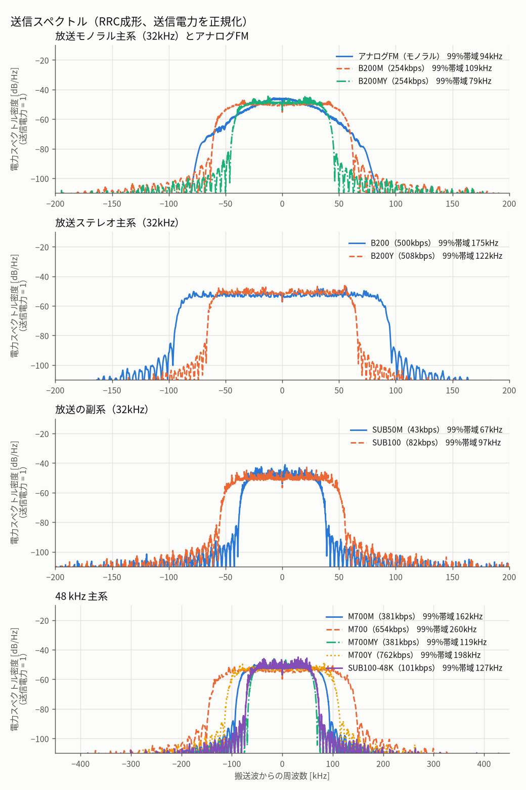

# GraceFM：Haar帯域分割を用いた低遅延デジタル音声伝送

## 要旨

GraceFMは、64サンプルの音声を正規直交Haar変換し、帯域別に量子化して無線シンボルへ写像する方式である。フレームは、FEC付きの**ヘッダ**（ヘッダ・指数・区間アッテネータ・CRC）と、**Haar係数部**（仮数上位bitのパリティと、FECなしの仮数bit）に分ける。Haarの高域H2/H1には別のCRCを割り当てる。QPSK、強弱のある階層16QAM、高域M係数を1係数1複素シンボルで送るY方式（QASK）を定義する。受信側は軟判定復号、任意の2周波数系統の帯域別融合、LPCによる連続欠落の補間を行い、出力段にLanczosオーバーサンプリングのポストフィルタ（48 kHz/int32）を置く。本書は[参照実装](../gracefm/)のアルゴリズムと[計算した設定表](PROFILES.md)を記述する。数値はオフラインシミュレーションであり、実機のRF性能、同期取得、法規適合性を示すものではない。

## 1. 信号モデルと帯域

入力はサンプリング周波数 $`f_s=32`$ または $`48`$ kHzの左右PCMとし、$`M=(L+R)/2`$、$`S=(L-R)/2`$ に変換する。モノラルのプロファイルはMのみを送る。1フレームは64サンプルで、フレーム周期は $`T_f=64/f_s`$、すなわち32 kHzで2 ms、48 kHzで約1.333 msである。音声ブロック内に先読みはない。[codec.py](../gracefm/codec.py)が変換と量子化を実装する。

Haar分解は偶数・奇数の組ごとに $`a'=(x_{2i}+x_{2i+1})/\sqrt2`$、$`d=(x_{2i}-x_{2i+1})/\sqrt2`$ を、最低域の帯域幅（$`f_s/2^{L+1}`$）が2 kHzを下回る最小の段数 $`L`$ だけ繰り返す。32 kHzも48 kHzも $`L=4`$ である。$`k=0`$ は最終近似、$`k=1,\ldots,4`$ は低域から高域への詳細帯域で、各ブロックの係数数は順に $`4,4,8,16,32`$ である。32 kHzでは $`k=0\ldots4`$ が 0–1、1–2、2–4、4–8、8–16 kHz に対応し、H2（$`k=3`$）が4–8 kHz、H1（$`k=4`$）が8–16 kHzである。48 kHzでは 0–1.5、1.5–3、3–6、6–12、12–24 kHzに対応する。Haarの帯域は理想的な矩形周波数帯域ではない。

Haar係数とPCMは、$`\pm1`$ を固定小数点にした同じスケールの整数で表せる（24 bit PCMなら1が $`2^{23}`$）。逆量子化は仮数のシフト、Haar合成は整数の和・差と $`1/\sqrt2`$ の固定小数点乗算で書ける。$`1/\sqrt2`$ を16 bitの定数（46341/65536）にしたときの相対誤差は約 $`10^{-6}`$（見積もりで、実装での測定ではない）で、仮数7〜11 bitの量子化誤差より十分に小さい。参照実装は、この計算を整数だけで行い、乗算器の幅とDSPの制約に合わせている（[固定小数点実装](FIXED.md)）。

## 2. 帯域別の量子化と音声データ量

各成分・帯域の仮数幅 $`b_{c,k}`$ と共有指数幅はプロファイルで固定する。仮数幅は、上位Kbitのパリティ（Kbit）と合わせて2の倍数になる値にする。K=1なら奇数で、現行の主系は最低域（$`k=0`$）が $`K=2`$ の10 bit、ほかの帯域が $`K=1`$ の11/7/3 bit、QPSK副系は7〜3 bitを使う。階層16QAMでは、位相部（基本層の仮数＋パリティ）と振幅部（拡張層）をどちらも2の倍数にする（3.2節）。係数 $`x_{c,k,j}`$ の量子化値は

```math
m_{c,k,j}=\text{clip}\!\left(\text{round}\!\left(\frac{x_{c,k,j}}{2^{e_{c,k}-a_{c,k,j}}}\right),q_{\min},q_{\max}\right),\qquad q_{\max}=2^{b_{c,k}-1}-1.
```

$`a_{c,k,j}\in\{0,1\}`$ は区間アッテネータで、1なら量子化刻みを半分にする。全登録プロファイルの送信成分に少なくとも一つの区間を持たせる。指数は帯域内で共有し、整数の指数インデックス $`e-e_{\min}`$ を送る。送信機はピークから決めた指数と、その1段下の候補について、区間ごとにアッテネータ0/1を選び、二乗誤差が小さい組を採用する。アッテネータはRF出力電力を下げる機能ではない。通常の仮数範囲は $`[-q_{\max},q_{\max}]`$、Y高域だけは負端に1値多い範囲を使う。

1フレームの音声データ量は、送る各成分・帯域について

```math
P=\sum_{c,k:b_{c,k}>0}\left[E_{c,k}+A_{c,k}+n_k b_{c,k}\right],\qquad R_{\rm audio}=P\frac{f_s}{64}.
```

である。$`E`$ は指数bit数、$`A`$ は区間アッテネータbit数、$`n_k`$ は係数数。$`R_{\rm audio}`$ は量子化表現の名目ビットレートで、ヘッダ、CRC、FEC、プリアンブル、詰め物を含まない。Y方式の高域仮数も8bit表現として数えるが、その非保護部分はデジタルbit列ではなく専用シンボルの半径へ写像する。帯域別の全幅、指数、区間長は[設定マトリクス](PROFILES.md)に記載する。

## 3. フレームフォーマットと誤り訂正

1音声ブロックが1無線フレームに対応する。誤り訂正は、位相部（階層16QAMの強い2位置）にパリティ、振幅部（弱い2位置）にデータを置く**系統符号**に統一する。1シンボルが「パリティ2bit｜データ2bit」になり、FEC付きの部分も強弱の位置を使い切る。

系統符号は、$`(133,171)_8`$ の符号語集合を、情報bit $`x`$ を第1系列とする再帰形で使う。入力 $`u_t=x_t\oplus u_{t-2}\oplus u_{t-3}\oplus u_{t-5}\oplus u_{t-6}`$、パリティ（第2系列）は $`c_{1,t}=u_t\oplus u_{t-1}\oplus u_{t-2}\oplus u_{t-3}\oplus u_{t-6}`$。情報bit $`n`$ 個に対し、パリティ $`n+6`$ bit と終端の情報bit 6 bit を送る（終端はゼロの入力 $`u`$ を6回続けて状態を0に戻す）。受信側はデータとパリティの軟値を同じ尺度の対数尤度比で合わせ、軟判定ビタビで復号する。パリティは因果的で、先頭 $`m`$ bit のパリティは先頭 $`m`$ bit だけで決まる。[fec.py](../gracefm/fec.py)に実装する。

```text
フレーム:   プリアンブル16シンボル | ヘッダ | 終端 | 係数 | 詰め物 | Y高域Mの専用シンボル※
            位相部（強い2位置）: ヘッダのパリティ n+6 | 終端のパリティ 6（+Y用 6）| 係数ごとに [パリティ K | 基本層の仮数]
            振幅部（弱い2位置）: ヘッダの情報 n  + 終端 6 | 終端の情報 6（+Y用 6）| 係数ごとに [拡張層の仮数]
※ 該当帯域・方式にだけ存在する。QPSKは位相部・振幅部の区別がなく、同じ順に並べるだけ。
```

**ヘッダ**の情報bitは、ヘッダ24bit、指数、区間アッテネータ、基本CRC 12、高域CRC 10※の順。ヘッダは `プロファイルID 4 | 系統ID 1 | 暗号化フラグ 1 | 形式識別子 2 | フレーム番号 16` で、形式識別子は固定ビット値 `11` であり、製品の世代番号ではない。暗号化時はフレーム番号が24bitとなり、ヘッダは32bitになる。ID 0、12～15は予約である。指数とアッテネータは M→S、低域→高域の順に並べる。**基本CRC**はヘッダ、$`k=0\ldots2`$ の指数・アッテネータ、およびそれらの帯域の仮数上位 $`K`$ bit を、**高域CRC**は $`k=3,4`$ の指数・アッテネータ、仮数上位 $`K`$ bit、Y帯域の最上位bitを検査する。ヘッダは短いので、基本CRCは12bit（多項式 `0x80F`）、高域CRCは10bit（多項式 `0x233`）とし、初期値は全ビット1、MSBから計算する。高域を送らないプロファイルには高域CRCを付けない。CRCは、ヘッダと係数のパリティを復号した後に確認し、上位 $`K`$ bit は訂正後の値を使う。

**係数**はすべての仮数bitを成分M→S、帯域低→高、係数先頭→末尾の順に並べ、各係数をシンボル単位で分ける。位相部には、その係数の上位 $`K`$ bit のパリティ $`K`$ bit と基本層の仮数bit（rank の小さい順）を、パリティ、データの順に1bitずつ交互に置き（どちらかが尽きたら残りを続ける。$`K=1`$ なら最上位bitがパリティの隣に入る）、振幅部には拡張層の仮数bit（rank の小さい順）を置く。パリティは係数の先頭側のシンボルの位相部に並ぶ。パリティが守るのは、各係数の上位 $`K`$ bit（基本層の先頭）である。$`K`$ はプロファイルごとに決め、現行カタログは全帯域で1である。仮数bit自体にFEC・CRCは付けない。Y方式の高域Mは仮数がこの列に無く、専用シンボルの位相に最上位bitとそのパリティを載せる（第4章）。終端の情報bitは振幅部に、パリティbitは位相部にあり、ヘッダと係数、Y帯域のそれぞれに6 bitずつ（Y無しなら係数とヘッダの2組）。

送信シンボル列は `16シンボル既知プリアンブル | デジタルシンボル | Y専用シンボル（Y系のみ）` の順。位相部の列と振幅部の列は同じ長さの偶数にそろえ（足りない側の末尾を0で埋める）、PRBS `1+x^14+x^15` で詰め物も含めてスクランブルする。Y部は別の3bit/係数のマスクを使う。暗号化を選ぶ場合、ヘッダ以外のヘッダの内容と仮数bitをAES-128-CTRのキーストリームとXORし、暗号文にCRCとパリティを適用する。Y系の暗号化は参照実装にない。鍵共有と認証も対象外である。[framing.py](../gracefm/framing.py)がビット順と検査範囲を定義する。

### 3.1 ビットからシンボルへの予算

位相部の列の長さを $`N_P`$、振幅部の列の長さを $`N_W`$ とし、デジタルシンボル数は $`N_d=\lceil\max(N_P,N_W)/2\rceil`$（QPSKは位置がすべて同じなので $`N_d=\lceil N_{\rm tx}/2\rceil`$）、フレームのシンボル数は

```math
N_f=16+N_d+N_Y,\qquad R_s=N_f\frac{f_s}{64}.
```

$`N_Y`$ はY帯域の専用シンボル数で、通常方式は0、登録Y系はMだけをYにするB200MYとM700MYが56、MとSをYにするB200YとM700Yが112である。[modem.py](../gracefm/modem.py)と[txrx.py](../gracefm/txrx.py)がこの計算を使う。デジタル変調位置の総速度は $`R_{\rm slots}=mN_df_s/64`$ bit位置/s（$`m=2`$：QPSK、4：階層16QAM）で、ヘッダ、パリティ、詰め物を含み、プリアンブルとY専用シンボルは含まない。これは正味の音声ビットレートではない。

例えばB200Mでは $`P=508`$ bit/フレーム（指数・アッテネータ・仮数）、$`R_{\rm audio}=254`$ kb/s。ヘッダの情報は78bit（CRC込み）で、ヘッダが $`(78+6)/2=42`$ シンボル、上位bitの終端が3シンボル、64個の係数が136シンボル（位相部と振幅部が各272bit）で、デジタル181シンボルにプリアンブル16を加えて197シンボル/フレーム、$`R_s=98.5`$ ksym/sである。

### 3.2 基本層・拡張層の配分

係数をシンボル単位で分け、位相部（強い2位置）に置く仮数bitが**基本層** $`a`$、振幅部（弱い2位置）に置く仮数bitが**拡張層** $`e=w-a`$ である。位相部の先頭にはパリティ $`K`$ bit も入るので、位相部（$`a+K`$）と振幅部（$`e`$）をどちらも**2の倍数**にし、係数ごとに $`a+K=e`$ にそろえる。仮数幅は $`w=a+e`$ で、$`K=1`$ で $`N`$ シンボルを使う係数は $`a=2N-1`$、$`e=2N`$、$`w=4N-1`$ bit（現行カタログのほかの帯域は11/7/3 bit）になる。$`K=2`$ なら $`a=2N-2`$、$`e=2N`$、$`w=4N-2`$ bit（最低域は $`N=3`$ で10 bit）になる。ヘッダと終端は位相部と振幅部に同数ずつ入るので、強い位置と弱い位置の差に効かず、詰め物は偶数そろえの高々1個になる。[layers.py](../tools/common/layers.py)がこの配分を計算し、計算結果は[設定マトリクス](PROFILES.md)に基本層（仮数のみ）・拡張層として載せる。Y方式の高域Mは配分の対象外で、そのためY系ではデジタル部の弱い位置に余りが出る。

## 4. 変調方式

**QPSK**は副系 `SUB` に使う。副系 `SUB` はステレオ差分成分 $`S=(L-R)/2`$ と無関係であり、登録ステレオ主系のSは階層16QAMで送る。QPSKは各複素シンボルのI/Qに1bitずつ、0を正、1を負として置き、平均シンボルエネルギーを1に正規化する。**階層16QAM**は各軸の符号bitを強い位置、半径側のGray符号bitを弱い位置に置く。登録プロファイルの階層パラメータは $`\alpha=5`$ で、各軸の絶対値は正規化前に $`\alpha`$ と $`\alpha+2`$。強い2位置を全シンボルに先に埋め、次に弱い2位置を埋める。通常16QAM（$`\alpha=1`$）は登録していない。

**Y方式**ではY帯域（登録プロファイルは32 kHzで2–4、4–8、8–16 kHzの $`k=2,3,4`$）の仮数を1係数につき1複素シンボルへ写像する。7bit仮数 $`u`$ の最上位bit $`m`$ とそのパリティ $`c`$ を位相、下位6bit $`L`$ を半径に割り当てる。象限番号は $`q=[0,1,3,2]_{2m+c}`$（Gray割当で、隣の象限へ誤ると $`m`$ か $`c`$ の片方だけが変わる）、$`\theta=\pi/4+q\pi/2`$、$`r=[1+\delta(L-31.5)]/C`$、$`z=re^{i\theta}`$ とする。$`\delta=2/105`$（$`0.08\times7.5/31.5`$ に等しい）、$`C`$ は全点の平均エネルギーを1にする係数。パリティは、Y帯域の最上位bit列（係数順）に対する(133,171)符号の第2系列で、位相に載せるため追加のシンボルを使わない。終端の12bitだけはヘッダ側の強い位置に置く。受信側はまず位相の対数尤度比から最上位bitとパリティを得て、終端bitと合わせてビタビ復号し、訂正後の最上位bitとパリティで象限を決めてから、受信点を象限の軸へ射影して半径の段を1/2刻み（段6 bit + 小数1 bit = 7 bit。最上位bitの位相1 bitと合わせて仮数が8 bit）で推定し、誤差分散を求める。最上位bitは、Y帯域が高域（$`k\ge3`$）にある分は高域CRCの、それより低い帯域にある分は基本CRCの検査範囲に入る。Y対象はプロファイルが決め（M系は $`M`$ のみ、B200YとM700Yは $`M`$ と $`S`$）、Y対象でない成分はデジタル部に残る。Y専用シンボルを加えても、Y帯域の仮数はHaar係数部に入らないため強い位置の消費が減り、32 kHz系ではY無しの主系より占有帯域が小さくなる。

B200YはステレオY主系で、Mの全幅は `(10,11,7,7,7)`（$`k=2,3,4`$ がY）、Sは `(10,11,7,7,7)`（同）。低中域MとSのデジタル部は階層16QAMであり、SだけをQPSKへ切り替える仕組みはない。M700M/M700MYも階層16QAMで、位相部（基本層＋パリティ）と振幅部（拡張層）を係数ごとにそろえる。M700のS割当は `(10,7,7,7,3)`、M700YのS割当は `(10,11,7,7,7)`（$`k=2,3,4`$ がY）である。

## 5. 受信、欠損データ、出力段

受信機は、シンボルを小数22 bitの固定小数点に変換し（IQは受け取った段階の12 bit ADC出力から変換）、受信点と最寄りの信号点との差から軸あたりの雑音分散をフレームごとに推定して、軸ごとに独立なmax-logのLLR（符号つき8 bitの整数）を得る。PRBSを戻し、ヘッダと係数のパリティを、データの軟値と合わせて復号し、CRCを検査する。基本CRCが不一致ならそのフレームを欠落とする。CRCは、ヘッダを復号し、パリティとHaar係数部の上位 $`K`$ bit の軟値から上位bitを訂正した後に確認する。高域CRCだけが不一致ならH2/H1のM/S係数を0にし、低中域は使う。Y帯域の最上位bitのうち $`k=2`$ の分は基本CRCの範囲なので、その不一致はフレーム欠落になる。高域の融合用誤差分散は無限大とし、もう一方の系統に正常な高域があればそちらを選ぶ。上位 $`K`$ bit を除くHaar係数部のbitは、LLRからテーブルで引いた事後確率 $`p_1`$（Q15の整数）を使い、仮数の期待値を $`E[u]=u_{\rm hard}+\sum(p_1-b_{\rm hard})2^{\rm pos}`$、事後分散を $`\sum p_1(1-p_1)4^{\rm pos}`$ として復元する。CRCで非保護bitの誤りまで検出したと解釈してはならない。

### 5.1 出力段のポストフィルタ

Haar合成後の左右PCM（符号つき24 bit整数）を32 bitに広げ、Lanczos補間で4倍にオーバーサンプリングする。補間核は $`L(x)=\mathrm{sinc}(x)\,\mathrm{sinc}(x/a)$、$`|x|<a`$、$`a=8`$ で、元の標本点は変えず間を補間する。続いて元のナイキスト周波数の98%を通過域端とする511タップの線形位相FIR（Kaiser窓）で鏡像を落とし、48 kHzへダウンサンプルしてint32で出力する。32 kHz系は128 kHzから48 kHzへ3/8、48 kHz系は192 kHzから48 kHzへ1/4に変換する。フィルタ係数は符号つき18 bitの整数（Q16またはQ17、`gracefm/tables.py`）で、積和は64 bit整数、各段の出力は四捨五入して右シフトする。量子化区間への射影や、ブロックをまたぐ平滑化は行わない。[postfilter.py](../gracefm/postfilter.py)に実装する。

Lanczos補間の先読みは入力 $`a=8`$ サンプル、LPFの群遅延はオーバーサンプル後の255サンプルである。[timing.py](../gracefm/timing.py)の遅延モデルには別途加える。ツールでは `tools/sim/codec_wav.py` と `tools/sim/sim_link.py` が既定でこのポストフィルタを通した48 kHz/int32のWAVを書き出し、`--no-postfilter` で元のサンプリング周波数の出力にできる。評価値（SNRやViSQOL）はポストフィルタの前の出力で測る。

### 5.2 二系統融合と連続欠落の処理

副系を使う場合は別周波数の独立したストリームとして同じ音声を送り、64サンプルの格子は主系と同じにする。受信機はブロック単位で両系統を時刻合わせし、M/Sの各Haar係数に推定誤差分散 $`R_A,R_B`$ の逆数で重みを付ける（誤差分散は帯域ごと・半ブロックごとに見積もり、2係数以上の帯域は前半の係数に前半、後半の係数に後半の値を使う）。$`w_A=(1/R_A)/(1/R_A+1/R_B)`$。片系統だけ有効ならその系統を使い、未送信またはCRCで消去した帯域は $`R=\infty`$ とする。副系の電力と帯域は主系と別に計上する。[fusion.py](../gracefm/fusion.py)に融合の実装がある。

**設計コンセプト（冗長経路）。** 副系は、別の局のB200系チャンネルの空き帯域に置くSUB50Mを標準の想定とする。副系は主系と別の送信機・別周波数から来るので、主系と電力を分け合わず、受信C/N0も主系と独立に扱う。チャンネルを増やさずに冗長経路を作るのが目的で、受信機は2つの周波数を同時に受ける。運用上の帯域条件は200 kHzまでとし、これとは別に100 kHzのクリアランスがある（運用者の条件で、本書では測定していない）。SUB50Mの99%占有帯域は67.0 kHz（6節）なので、ホスト主系の空きは200 kHzから99%占有帯域を引いて、B200Mで91.3 kHz、B200MYで121.1 kHz、B200Yで77.4 kHz、B200で24.8 kHzである。B200ではSUB50Mが200 kHz内に収まらず、クリアランスに置く必要がある。隣接チャンネルへの漏れは測定していない。SUB系は仮数を $`k=0\ldots2`$（0〜4 kHz）の低域だけに置き、H2/H1（$`k=3,4`$）は運ばない。32 kHzの理想AWGNで、主系・副系とも全電力・雑音独立の評価では、B200にSUB50Mを足すとSUB100の約半分の帯域で近い効果が得られた（6素材10秒の平均、主系C/N0 62、副系62で、ViSQOLは2.57→2.90、SNRは20.8→27.5 dB。SUB100は2.99／29.5 dB）。SUB50Mはモノラルなので、主系が壊れた領域（C/N0 58〜60）ではSUB100よりSNRが1〜2.5 dB低い。モノラル同士の組み合わせ、フェージングやゴーストの条件は評価していない。

情報のある（系統、成分、帯域）の組が変わったブロック（主系が欠落して副系だけになる、高域CRCの不一致で高域が消える、復帰する）では、先頭16サンプルを直前の出力のLPC外挿から新しい出力へクロスフェードでつなぎ、波形の段差を抑える。先読みを使わないので遅延は増えない。ノイズなしで主系が欠落と復帰を繰り返す条件（主系の受信率0.68）で、誤差信号の2階差分のブロック境界での大きさを境界以外の大きさで割った比が、2.21から1.83に下がった（この比は本書で定めた指標で、聴感との対応は確認していない。ViSQOLは1.823から1.827）。両系統で同一区間が欠けた場合は、直前最大128サンプルから次数16のLPCを推定して外挿する。最初の10 msはゲイン1を保持し、その後20 msで0へ減衰する。復帰時は16サンプルで予測値から受信値へクロスフェードする。[plc.py](../gracefm/plc.py)に係数推定とゲイン包絡を実装する。

### 5.3 RRCフィルタとゴースト用等化器

送信スペクトルの評価では、シンボルを8倍にアップサンプルし、エネルギー正規化したルートレイズドコサイン（RRC）FIRで成形する。ロールオフ $`\beta`$ と長さはプロファイルで固定し、放送ステレオ主系B200/B200Yは $`\beta=0.10`$、長さ32シンボル、その他の登録プロファイルは $`\beta=0.25`$、長さ16シンボルである。[pulse.py](../tools/common/pulse.py)がRRCを生成する。

建物などによる遅延反射波（ゴースト）は、直接波と重なってシンボル間干渉を作る。評価用通信路では、送受信RRCの整合フィルタ後にシンボル時刻で標本化し、次の等価モデルを使う。

```math
y[n]=\sum_{\ell}h[\ell]x[n-\ell]+v[n].
```

$`h[\ell]`$ は直接波と各反射波をRRC波形に通して得る複素タップである。遅延が整数シンボルに一致しない場合も8倍標本のRRC応答を補間してタップを作る。別周波数の副系では、同じ反射遅延 $`\tau`$ でも主系との搬送波間隔 $`\Delta f`$ により反射位相が $`-2\pi\Delta f\tau`$ だけ変わる。モデルと雑音の加え方は[equalizer.py](../gracefm/equalizer.py)の `matched_channel_taps`、`through_matched_channel` に定義する。

受信側は初めの100フレーム（32 kHzでは0.2秒）を校正に使う。既知の16シンボルのプリアンブルと、フレーム番号を追跡できている場合のヘッダ符号bitの符号位置から、まず通信路タップを最小二乗推定する。階層QAMのヘッダシンボルでは振幅bitは未知なので平均振幅を使う。その後、校正フレーム内の判定シンボルを使って2回推定を更新する。校正後のフレームを使って校正値を求めることはない。

推定タップと残差雑音電力から11タップの線形MMSE FIR等化器を設計する。先読みを0～4シンボルの範囲で選び、目標タップの利得を1に正規化したうえで、残留シンボル間干渉と雑音増幅の和が小さい解を採用する。主系と副系は各々の周波数で別々に等化し、その後に復調・CRC検査・帯域別融合を行う。[tests/test_equalizer.py](../tests/test_equalizer.py)では、B200Mの静的な5 µs・−10 dBの反射波、$`E_s/N_0=24`$ dBの条件で、校正後のシンボル誤差電力が等化前の5分の1未満になることと、将来フレームを校正に使わないことを検査する。

この等化器は静的ゴーストの**緩和**を評価する任意の前処理で、通常の `receive` 経路には自動接続されない。[eval_ghost.py](../tools/eval/eval_ghost.py)は主系・副系をそれぞれ `equalize_static` に通してから `receive` へ渡す。搬送波・シンボル時刻の取得は理想化し、移動で反射波が変化する場合の追従、実機でのゴースト除去率は検証していない。送受信RRCと等化器の先読み遅延は[timing.py](../gracefm/timing.py)で別途加算する。

## 6. ビットレートと送信帯域

表の音声量は第2節の $`R_{\rm audio}`$、シンボルレートはプリアンブルとY専用シンボルを含む $`R_s`$ である。理論支持幅は無限長RRCの式 $`B_{\rm RRC}=(1+\beta)R_s`$ による両側帯域幅である。99%占有帯域は4秒の `piano`（モノラル形）音源を連続フレーム化し、8倍サンプルのRRC波形についてWelch法で推定した電力スペクトルの0.5%～99.5%点間を測った値。[測定スクリプト](../tools/report/spectrum.py)と[数値JSON](results/spectrum.json)を参照。

| 系列 | ID | プロファイル | 変調 | 音声量 kb/s | シンボル/フレーム | $`R_s`$ ksym/s | $`\beta`$ | 理論支持幅 kHz | 99%占有帯域 kHz |
|---|---:|---|---|---:|---:|---:|---:|---:|---:|
| 放送モノラル | 1 | B200M | 階層16QAM | 254 | 197 | 98.5 | 0.25 | 123.125 | 108.7 |
| 放送ステレオ | 2 | B200 | 階層16QAM | 500 | 345 | 172.5 | 0.1 | 189.75 | 174.9 |
| 放送モノラル | 3 | B200MY | 階層16QAM＋Y | 254 | 144 | 72 | 0.25 | 90 | 78.9 |
| 放送ステレオ | 4 | B200Y | 階層16QAM＋Y | 508 | 240 | 120 | 0.1 | 132 | 122.3 |
| 32 kHz副系 | 5 | SUB50M | QPSK | 43 | 122 | 61 | 0.25 | 76.25 | 67 |
| 32 kHz副系 | 6 | SUB100 | QPSK | 82 | 176 | 88 | 0.25 | 110 | 97.3 |
| 48 kHz主系 | 7 | M700M | 階層16QAM | 381 | 197 | 147.75 | 0.25 | 184.688 | 162.2 |
| 48 kHz主系 | 8 | M700 | 階層16QAM | 654 | 313 | 234.75 | 0.25 | 293.438 | 260.4 |
| 48 kHz主系 | 9 | M700MY | 階層16QAM＋Y | 381 | 144 | 108 | 0.25 | 135 | 118.5 |
| 48 kHz主系 | 10 | M700Y | 階層16QAM＋Y | 762 | 240 | 180 | 0.25 | 225 | 198.3 |
| 48 kHz副系 | 11 | SUB100-48K | QPSK | 101.25 | 155 | 116.25 | 0.25 | 145.312 | 127.1 |



*図1：同じ素材で生成した連続フレームの複素ベースバンドPSD。各波形の平均送信電力を1に正規化した。*

Y系は、Y帯域（2 kHz以上の3帯域）の仮数をHaar係数部から外し、1係数1シンボルの位相に最上位bitとそのパリティを載せ、区間アッテネータも4区間ずつに粗くするため、Y無しの主系より占有帯域が小さい（B200MYはB200Mより約30 kHz、B200YはB200より約53 kHz、M700MYはM700Mより約44 kHz、M700YはM700より約62 kHz）。B200Yの99%占有帯域は122.3 kHz、M700Yは198.3 kHzで、どちらも200 kHzを下回る。

99%占有帯域と理論支持幅は異なる。測定した放送主系はB200Mで約109 kHz、B200で約175 kHzであり、−30 dB幅はプロファイルごとに異なる。後者の数値は測定JSONに記録した。ステレオで帯域を下げるには、Sの高域か高域Mの幅を減らす必要があり、音質が大きく下がる。単一主系の値を主系＋副系2周波数の合計帯域と混同してはならない。占有帯域の測定だけで180 kHzチャンネルへの適合や隣接チャネル漏洩は保証できない。

### 6.1 16 bit PCMとの比較

音声量を同じサンプリング周波数・チャンネル数の16 bit PCMと比べる。**圧縮率**は16 bit PCMのビットレート（$`f_s\times`$チャンネル数$`\times16`$）を音声量で割った値。**PCM換算bit**は、コーデックだけを通した波形SNRから理想的な一様量子化の関係 $`(\mathrm{SNR}-1.76)/6.02`$ でbit数に直した値で、`demo`・`piano`・`percussion`（各10秒）の平均である。これは音楽のレベルでの値で、ダイナミックレンジではない。係数は帯域ごとに共有指数（4 bit）を持つ浮動小数点に近い形なので、入力が小さくなっても相対精度が保たれ、下のとおり波形SNRは広い範囲でほぼ一定である。[測定スクリプト](../tools/report/pcm_equivalent.py)と[数値JSON](results/pcm_equivalent.json)を参照。

| 系列 | プロファイル | 音声量 kb/s | 16 bit PCM kb/s | 圧縮率 | 波形SNR dB | PCM換算 bit |
|---|---|---:|---:|---:|---:|---:|
| 放送モノラル | B200M | 254 | 512 | 2.02 | 55.8 | 9.0 |
| 放送ステレオ | B200 | 500 | 1024 | 2.05 | 54.8 | 8.8 |
| 放送モノラル | B200MY | 254 | 512 | 2.02 | 56.1 | 9.0 |
| 放送ステレオ | B200Y | 508 | 1024 | 2.02 | 55.8 | 9.0 |
| 32 kHz副系 | SUB50M | 43 | 512 | 11.91 | 23.6 | 3.6 |
| 32 kHz副系 | SUB100 | 82 | 1024 | 12.49 | 22.4 | 3.4 |
| 48 kHz主系 | M700M | 381 | 768 | 2.02 | 57.0 | 9.2 |
| 48 kHz主系 | M700 | 654 | 1536 | 2.35 | 47.7 | 7.6 |
| 48 kHz主系 | M700MY | 381 | 768 | 2.02 | 57.2 | 9.2 |
| 48 kHz主系 | M700Y | 762 | 1536 | 2.02 | 56.6 | 9.1 |
| 48 kHz副系 | SUB100-48K | 101.25 | 1536 | 15.17 | 22.0 | 3.4 |

主系は約2倍の圧縮で、波形SNRは55〜57 dB（PCM換算で8.8〜9.2 bit）である。M700だけが7.6 bitと低い。素材別の波形SNRは `demo` 40.4 dB、`piano` 49.3 dB、`percussion` 53.4 dBで、`demo` が低い。副系は低域だけを送るため、帯域外が欠け、圧縮率は12〜15倍、波形SNRは22〜24 dB（3.4〜3.6 bit）にとどまる。

**入力レベルと波形SNR。** 入力の振幅を下げ、コーデックだけを通した波形SNR（dB）を測った（`piano` / 1 kHz正弦波。0 dBはピーク0.89）。

| プロファイル | 0 dB | −40 dB | −60 dB | −80 dB | −90 dB | −100 dB |
|---|---:|---:|---:|---:|---:|---:|
| B200M | 52.6 / 49.1 | 52.7 / 50.9 | 46.8 / 50.5 | 27.3 / 40.4 | 19.4 / 28.8 | 14.3 / 20.7 |
| B200 | 50.7 / 49.1 | 50.7 / 50.9 | 43.9 / 50.5 | 24.2 / 40.4 | 16.3 / 28.8 | 11.7 / 20.7 |
| M700M | 55.0 / 51.7 | 55.0 / 50.9 | 47.0 / 54.1 | 27.5 / 41.6 | 21.2 / 29.0 | 15.8 / 18.2 |
| M700 | 49.3 / 51.7 | 49.1 / 50.9 | 36.0 / 54.1 | 24.4 / 41.6 | 17.6 / 29.0 | 13.7 / 18.2 |

`piano` ではB200M・B200・M700Mとも入力が−40 dBまで下がっても波形SNRはほぼ変わらない（M700は−40 dBで49.1 dB、−60 dBで36.0 dBに下がる）。正弦波ではさらに−60 dBまで約50 dB以上を保ち、−90 dBで約29 dB、−100 dBで約18〜21 dBである。−120 dBでは6〜9 dBになる（係数の小数22 bitによる下限）。**ダイナミックレンジとbit数。** 波形SNRが20 dBを下回り始める入力レベル（測定点の間は直線補間）を下限とし、フルスケールからの幅をbit数にした。**フルスケールからの幅**は下限レベルを6.02 dB/bitで割った値、**同等PCM bit**は1 kHz正弦波で理想的な一様量子化のPCMが同じ20 dBを得るのに必要なbit数（$`\mathrm{SNR}=6.02n+1.76+\text{入力ピーク dB}`$ から $`n`$ を解いた値）である。

| プロファイル | 正弦波の下限 dB | フルスケールからの幅 bit | 同等PCM bit | pianoの下限 dB |
|---|---:|---:|---:|---:|
| B200M | -100.9 | 16.8 | 19.8 | -89.2 |
| B200MY | -103.3 | 17.2 | 20.2 | -91.6 |
| B200 | -100.9 | 16.8 | 19.8 | -85.3 |
| B200Y | -103.3 | 17.2 | 20.2 | -89.8 |
| M700M | -98.3 | 16.3 | 19.4 | -92.2 |
| M700MY | -105.2 | 17.5 | 20.5 | -93.2 |
| M700 | -98.3 | 16.3 | 19.4 | -86.5 |
| M700Y | -105.2 | 17.5 | 20.5 | -91.5 |

1 kHz正弦波の下限は98〜105 dBで、フルスケールからの幅は16.3〜17.5 bit、同じ20 dBを16 bit PCMで得るには19.4〜20.5 bitが必要になる。`piano` では下限が85〜93 dBで、正弦波より10 dB前後高い。通信路を通した場合の下限は測っていない。20 dB以外の基準や、SNRが0 dBになるレベルも測っていない。入力レベルごとの波形SNRの全数値は[JSON](results/pcm_equivalent.json)にある。

## 7. 遅延、評価範囲、再現方法

理想的に処理時間・フィルタ遅延を0とした場合、1フレームを蓄積してから1フレーム時間で送るので、最小の一定再生遅延は $`2T_f`$、32 kHzで4 ms、48 kHzで約2.667 msとなる。二系統融合でも、格子が同じなのでこの基準は同じ。実際にはRRC、等化器の先読み、符号化・復号、ADC/DAC、同期取得、出力バッファを加える。[timing.py](../gracefm/timing.py)はこれらを別々に与える計算モデルであり、実機遅延の実測ではない。

設定の正本は[profiles.py](../gracefm/profiles.py)の `PROFILE_MATRIX` で、[設定マトリクス](PROFILES.md)は `python tools/report/profile_matrix.py` で生成する。表の一貫性は `python tools/report/profile_matrix.py --check`、スペクトルは `python tools/report/spectrum.py`、試聴音声のファイルと設定の対応は `python tools/samples/sample_catalog.py` で検証できる。受信・CRC・帯域配置の動作は `tests/test_profiles.py`、`tests/test_gracefm.py`、`tests/test_y.py` を参照。FM・aptX・DAB+との比較条件と数値は[方式間比較](COMPARISON.md)に分けて記載する。

参照実装の主な通信路評価は理想同期のAWGNまたは指定した静的反射波である。周波数偏差、位相雑音、移動時の同期追従、ASICの面積・消費電力、量産コストは本書の測定対象外である。

### 7.1 想定ハードウェア

想定する実装は、HamGeek の Zynq-7010 ボードと AD9363 の組み合わせである。以下はデータシートの値で、本書は実機で動かしていない。

| 項目 | 値 | 出典 |
|---|---|---|
| AD9363 ADC/DAC | I・Qともに12 bit | [AD9363 データシート](https://www.analog.com/media/en/technical-documentation/data-sheets/AD9363.pdf) |
| AD9363 同調範囲 | 325 MHz〜3.8 GHz（Analog Devices の別資料に380 MHzとの記載があり、データシートの値を採った） | 同上 |
| AD9363 チャンネル帯域幅 | 200 kHz未満〜20 MHz | 同上 |
| Zynq-7010 論理 | 28Kロジックセル、LUT 17,600、FF 35,200 | [Zynq-7000 概要（DS190）](https://ranger.uta.edu/~jlosh/Xilinx/Zynq-7000_SoC_Overview.pdf) |
| Zynq-7010 DSP | 80スライス（18×25 乗算） | 同上 |
| Zynq-7010 ブロックRAM | 約2.1 Mb（36 Kb×60） | 同上 |

- 日本のFM放送帯（76〜108 MHz）とDAB帯（174〜240 MHz）は、AD9363の同調範囲の外にある。この構成で運用できる周波数は325 MHz以上である。
- 受信側の演算量とメモリは、処理ごとに数えた（[比較資料](COMPARISON.md)、`tools/report/circuit_estimate.py`）。B200+SUB100で約79〜185 MMAC/s、ビタビ約11.7 M ACS/s、メモリ約78 kbit（ブロックRAMは約2.1 Mb）である。同期（シンボルタイミング、搬送波、AGC）とAD9363とのインターフェースは設計がなく、含まない。論理は積み上げ見積もりで、B200+SUB100が約1,800 LUT・約1,400 FF・DSP 8個・ブロックRAM 13個（18 kbit）、Zynq-7010の約10%・約4%・10%・約11%である（仮定を含む見積もりで誤差は0.5〜2倍、同期などを含まない。[比較資料](COMPARISON.md)）。タイミングは、合成・配置配線をしていないので確認していない。
- 12 bitのADCの量子化雑音は、平均電力をフルスケールの1/4程度に置いた場合、信号に対して−60 dB程度と見積もる。通信路の雑音（Es/N0が2〜14 dB）より十分小さい。この見積もりは、ADCを入れたシミュレーションでは確認していない。隣接チャンネルの強い妨害波があるときのAGCの余裕は評価していない。

